# TCH's blitter board family

[](https://github.com/MS-DOS-Club/tch-blitter/actions/workflows/check.yml)

TCH SA was an arcade manufacturer from **Murcia, Spain**. Between 1993 and 1997 it built a line of
boards whose central idea was a **scaling blitter implemented in FPGA**: there are no tilemaps and no
sprite hardware. Everything on screen was copied there by the blitter, rectangle by rectangle, out of
the graphics ROMs.

This repository documents that line and **repairs its emulation in MAME**. Five games, six romsets
plus a fixed clone of one of them, one shared video architecture.

<table>
<tr>
<td width="20%">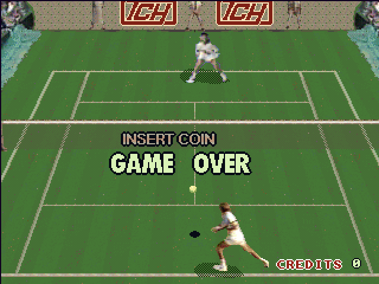</td>
<td width="20%">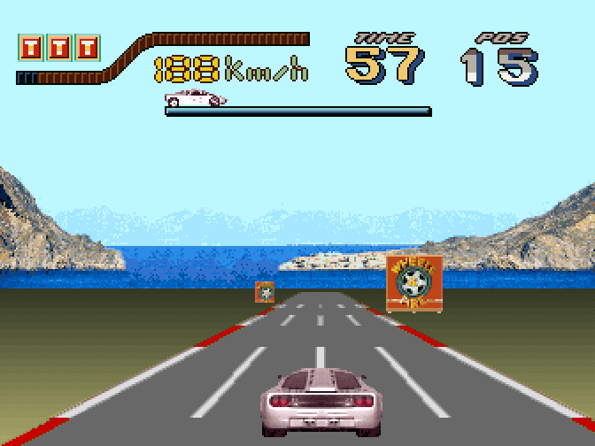</td>
<td width="20%">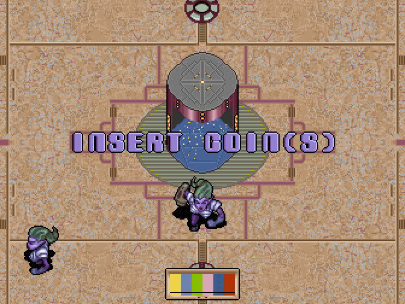</td>
<td width="20%">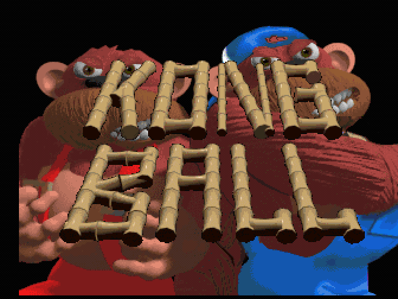</td>
<td width="20%">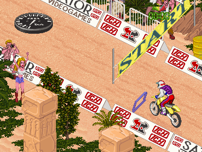</td>
</tr>
<tr>
<td align="center"><a href="docs/games/reality-tennis.md"><b>Reality Tennis</b></a></td>
<td align="center"><a href="docs/games/wheels-and-fire.md"><b>Wheels &amp; Fire</b></a></td>
<td align="center"><a href="docs/games/power-ball.md"><b>Power Ball</b></a></td>
<td align="center"><a href="docs/games/kong-ball.md"><b>Kong Ball</b></a></td>
<td align="center"><a href="docs/games/radical-enduro.md"><b>Radical Enduro</b></a></td>
</tr>
</table>

## The games

<!-- generated by scripts/gen-games.py: do not edit by hand [games-table] -->
| game | set | year | manufacturer | state in MAME | state here |
|---|---|---|---|---|---|
| [Reality Tennis](docs/games/reality-tennis.md) | `rltennis`, `rltennisa` | 1993 ⚠ | TCH | works, with imperfect graphics and timing | works, with imperfect graphics and timing |
| [Wheels & Fire](docs/games/wheels-and-fire.md) | `wheelfir` | 1997 * | TCH | NOT_WORKING | works, with imperfect graphics; plays a race to its time out |
| [Power Ball](docs/games/power-ball.md) | `pwball` | _unknown_ (`199?`) | TCH | NOT_WORKING (prototype), commented "mostly complete" | works, with imperfect graphics; plays a match to its game over |
| [Kong Ball](docs/games/kong-ball.md) | `kongball` | 1997 | TCH / Digital Dreams Multimedia | NOT_WORKING (prototype), no sound | works, with no sound and imperfect graphics; plays to its game over |
| [Radical Enduro](docs/games/radical-enduro.md) | `radendur` | _unknown_ (`199?`) | TCH / Sator Videogames | NOT_WORKING (early prototype) | NOT_WORKING (early prototype), the dump hangs on its own faults; the radendurv2 clone, its maincpu ROM fixed (plus full scenery, not the board's) and built from the dump, finishes a race with its music at its real 16 MHz |

`*` from an external source, not verifiable in the binary. `⚠` sources contradict each other: the game's page says which ones and why this value is the published one. `199?` is MAME's own: the year of those games was lost, and is not filled in.
<!-- end of generated block -->

TCH published six more video games (Little Robin, Speed Spin, Monsters World 1 and 2, Kick Goal and
Action Hollywood) on different architectures, out of scope here.

## Before and after

<!-- generated by scripts/gen-before-after.py: do not edit by hand -->
The same frames with MAME 0.288's driver on the left and this repository's on the right.
Each side runs with freshly created NVRAM. **The percentage is measured**, not estimated:
`uv run scripts/before-after.py` computes it and `uv run scripts/verify-images.py` checks it
still matches the caption.

<table><tr>
<td width="50%">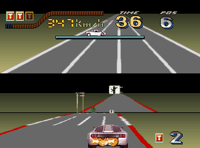</td>
<td width="50%">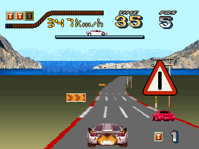</td>
</tr><tr>
<td align="center"><i>MAME 0.288</i></td>
<td align="center"><b>here</b></td>
</tr></table>

The original driver's signature failure: it draws the ROAD A SECOND TIME where the sky belongs, lane markings and all, with the real road below it. 82.8% of the pixels change. (`wheelfir`, frame 2300)

<table><tr>
<td width="50%">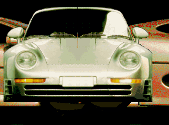</td>
<td width="50%">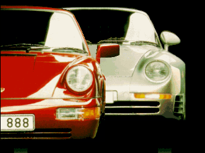</td>
</tr><tr>
<td align="center"><i>MAME 0.288</i></td>
<td align="center"><b>here</b></td>
</tr></table>

Of the two Porsches in the presentation the original driver draws only one, surrounded by leftovers of the previous screen. 66.8% of the pixels change. (`wheelfir`, frame 600)

<table><tr>
<td width="50%">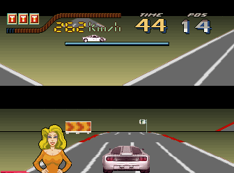</td>
<td width="50%">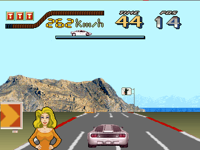</td>
</tr><tr>
<td align="center"><i>MAME 0.288</i></td>
<td align="center"><b>here</b></td>
</tr></table>

In-race, the original driver leaves the sky unpainted: no horizon, no mountain, no sea, none of the roadside signs. 76.4% of the pixels change. (`wheelfir`, frame 1800)

<table><tr>
<td width="50%">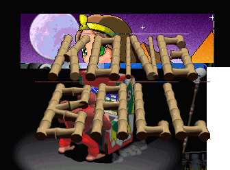</td>
<td width="50%">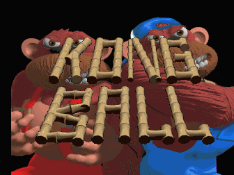</td>
</tr><tr>
<td align="center"><i>MAME 0.288</i></td>
<td align="center"><b>here</b></td>
</tr></table>

Kong Ball's title, which the original driver paints over the leftovers of the previous screen instead of over the gorilla. 76.7% of the pixels change. (`kongball`, frame 200)

<!-- end of generated block -->

## What this repository adds

Four of the five games are repaired here. The fifth, Reality Tennis, already worked in MAME; its
driver here adds the scale register, the blit spans and the picture's origin, read off the running
game. What is still open is listed
on each game's page, with what is known about each case and what is left to measure.

### The games that run

**Wheels & Fire, Power Ball and Kong Ball run on a rewritten `tch/wheelfir.cpp`**, whose video
model follows the hardware rather than the symptoms. The three are `NOT_WORKING` in stock MAME; here they
play their attract and their game. **Six of the eight open points the original driver's
author left written down are closed, and two remain open;
[the game's page](docs/games/wheels-and-fire.md) maps each of the eight to its state.** Each
correction is a model of the hardware rather than a patch of the game, and the evidence that backs
it is in `hardware/registers.yaml`.

**Not one byte of their ROMs is modified**, and that is stated precisely because the difference
decides what could reach MAME: the three run on the dumps exactly as they were preserved.

**And the result holds over long runs.** Left running at real speed, Wheels & Fire's attract loop
repeats lap after lap without drifting; its page details what stays constant lap to lap and what
varies with the game itself.

Wheels & Fire and Power Ball play their music and effects. Kong Ball has none, and that is not an
emulation fault: the board its dump came from was missing the sound ROMs.

### Radical Enduro, the one still in progress

**Radical Enduro is playable.** In stock MAME it is a `NOT_WORKING` prototype that never leaves its
opening screen; here, with its faults fixed, it boots, enters a race, and **five of its tracks run to
the finish**: the whole of Level 0 and the opening of the next two. It has its own driver,
`tch/radendur.cpp`, split out from its siblings'.

**`radendurv2` keeps its music through the race, and the game runs at the 16 MHz the board
specifies** with no clock multiplier. Both come from reading the 68000 rather than guessing: the sound is a sample streamer clocked by scanlines,
and the blitter interrupt is a **held level** timed by the game's own interrupt mask, not a pulse on
a fixed scanline.

**It is the exception on ROMs**: the faults are the prototype's own, so the driver emulates the
dump as it is (`radendur`, which hangs on them), and a clone set, `radendurv2`, loads a maincpu ROM
with the four faults fixed in its code, its sound block moved after the drawing as its finished
siblings place it, and, as a layer that is **not the board's behaviour**,
every prop near the view drawn where it belongs (the prototype's own engine leaves some zones
out, and puts the props of a row the view scrolls down into its top row). That ROM is
not distributed: `make v2` builds it from the verified dump, refusing any other input and any word
that is not what it expects.

Of its 16 track sections only five are playable: the rest carry data the prototype itself left
half-finished, and no emulator fixes that.

## The board

Two 68000 at 16 MHz, two Actel/TI TPC1020 FPGAs acting as a scaling blitter, a BT478 RAMDAC, an
ADC0808 for the wheel and a 10-bit R2R DAC for sound. The visible area is **336x252**: the board
scans 256 lines and shows 252, which are two different properties.

**Both drivers of this board (`tch/wheelfir.cpp` and `tch/radendur.cpp`) show those 252 lines.** Cropping the visible area does not disturb the sprite
plane's palette upload, even though that palette is pushed from the vblank callback: the push
happens at the END of vblank, and MAME makes vblank last exactly the lines the visible area does
not, so the push lands on the frame boundary whatever the crop is. This board's captures here are 252
rows tall for the same reason; Reality Tennis's board shows 320x240.

<!-- generated by scripts/gen-games.py: do not edit by hand [resources-table] -->
| game | main 68000 | sound 68000 | graphics | other ROMs |
|---|---|---|---|---|
| Reality Tennis | 1024 KB in 2 | -- | 5120 KB in 10 | samples1 512 KB, samples2 512 KB, plds 741 B |
| Wheels & Fire | 1024 KB in 2 | 1024 KB in 2 | 4096 KB in 8 | eeprom 128 B |
| Power Ball | 1024 KB in 2 | 1024 KB in 2 | 6656 KB in 13 | none |
| Kong Ball | 1024 KB in 2 | not dumped (empty sockets) | 4608 KB in 9 | plds 279 B |
| Radical Enduro | 1024 KB in 2 | 1024 KB in 2 | 7168 KB in 14 | plds 1482 B |

Read from the `ROM_START` blocks of the MAME drivers.
<!-- end of generated block -->

## The board pages

Two generations of the same design, one page each: the components, how the blitter is programmed,
the register map, the meaning of each bit and what is still unknown. The board pages' register
tables are generated from `hardware/*.yaml`, which is the canonical source.

| board | games | page |
|---|---|---|
| **Wheels & Fire board**, second generation, two 68000 at 16 MHz | Wheels & Fire, Power Ball, Kong Ball, Radical Enduro | [the Wheels & Fire board](docs/boards/wheels-and-fire-board.md) |
| **first generation**, one 68000 at 8 MHz | Reality Tennis | [the Reality Tennis board](docs/boards/reality-tennis.md) |

## Who made them

The ROMs still carry their teams' names. Two of them sign both boards, years apart, one of the
FPGAs is labelled after a member of the team, and Kong Ball seeds its team's initials into the
factory high-score table.

<!-- generated by scripts/gen-games.py: do not edit by hand [credits-table] -->
| game | who made it, according to its own ROM |
|---|---|
| [Reality Tennis](docs/games/reality-tennis.md) | **David Sandoval, Antonio A. Carrillo** (sole authorship) |
| [Wheels & Fire](docs/games/wheels-and-fire.md) | **Francisco Chacon** (EXECUTIVE PRODUCER); **Jose Sanchez** (PRODUCTIVE ADVISER); **David Sandoval** (HARDWARE DESIGN); **Antonio Carrillo** (PROGRAMMING); **Fernando Jimenez** (AUXILIAR PROGRAMMING); **Javier Martinez, Francisco Bocanegra, Joaquin Perez** (GRAPHICS) |
| [Power Ball](docs/games/power-ball.md) | _none legible in the ROM_ |
| [Kong Ball](docs/games/kong-ball.md) | **Jesus R. Alvarez** (PROGRAMMING); **Julio Lopez, Oscar Cuesta** (GRAPHICS); **Fernando Perez, Luis Fernando Fernandez** (contributors) |
| [Radical Enduro](docs/games/radical-enduro.md) | _none legible in the ROM_ |

Read from the ROMs themselves; the offset of each finding is in [docs/teams-and-signatures.md](docs/teams-and-signatures.md).
<!-- end of generated block -->

Power Ball and Radical Enduro sign nothing, and Radical Enduro's case is worth stating precisely:
**the whole attribution to Sator Videogames traces back to a single observation**, the logo drawn on its boot screen. No date, no
place, not one person, and no `SATOR` string anywhere in its 18 ROMs. It is published because it is
what MAME says, with this warning next to it.

## Credits and thanks

This repository stands on other people's work, and it is a pleasure to say so. First the authors of
MAME's original drivers, written by hand for boards nobody had documented; then everyone who kept
these boards alive, dumped their ROMs and brought them into MAME:

<!-- generated by scripts/gen-games.py: do not edit by hand [preservation-table] -->
| game | who preserved it |
|---|---|
| [Reality Tennis](docs/games/reality-tennis.md) | **Tomasz Slanina** (wrote MAME's original drivers for both TCH blitter boards, Reality Tennis's and Wheels & Fire's); **Antonio 'Peluko' Carrillo** (supplied the technical information behind the Reality Tennis driver); **Angelo Salese** (set Reality Tennis's CPU clock); **Smitdogg, The Dumping Union** (credited in the MAME commit that added Reality Tennis, which does not state the role); **Jordigahan, Ruben Casaña (Retro Arcadia Valencia)** (scanned the Reality Tennis manual); **Maria Morpalier** (located the set 2 board); **Jordigahan (Retrojapan.net)** (dumped and photographed the set 2 board); **Tomas Garcia-Meras** (took the readings of the set 2 board) |
| [Wheels & Fire](docs/games/wheels-and-fire.md) | **Tomasz Slanina** (wrote MAME's original drivers for both TCH blitter boards, Reality Tennis's and Wheels & Fire's); **David Haywood** (co-wrote MAME's first Wheels & Fire driver); **David Haywood** (improved the graphics emulation of Wheels & Fire and Power Ball); **Victor Fernandez (City Game)** (photographed the Wheels & Fire board); **Tomas Garcia-Meras** (collaborated on the Wheels & Fire entry) |
| [Power Ball](docs/games/power-ball.md) | **Tomasz Slanina** (wrote MAME's original drivers for both TCH blitter boards, Reality Tennis's and Wheels & Fire's); **David Haywood** (brought the three prototypes, Power Ball, Kong Ball and Radical Enduro, into MAME); **David Haywood** (improved the graphics emulation of Wheels & Fire and Power Ball); **Francisco Rabazas / OldComputers ES** (donated the board and dumped the ROMs); **OldComputers ES** (photographed the board) |
| [Kong Ball](docs/games/kong-ball.md) | **Tomasz Slanina** (wrote MAME's original drivers for both TCH blitter boards, Reality Tennis's and Wheels & Fire's); **David Haywood** (brought the three prototypes, Power Ball, Kong Ball and Radical Enduro, into MAME); **Francisco Rabazas / OldComputers ES** (donated the board and dumped the ROMs); **OldComputers ES** (dumped the PLDs of Kong Ball and Radical Enduro); **ClawGrip** (added OldComputers ES's PLD dumps of Kong Ball and Radical Enduro to MAME); **OldComputers ES** (photographed the board) |
| [Radical Enduro](docs/games/radical-enduro.md) | **Tomasz Slanina** (wrote MAME's original drivers for both TCH blitter boards, Reality Tennis's and Wheels & Fire's); **David Haywood** (brought the three prototypes, Power Ball, Kong Ball and Radical Enduro, into MAME); **Francisco Rabazas / OldComputers ES** (donated the board and dumped the ROMs); **OldComputers ES** (dumped the PLDs of Kong Ball and Radical Enduro); **ClawGrip** (added OldComputers ES's PLD dumps of Kong Ball and Radical Enduro to MAME); **OldComputers ES** (photographed the board) |

Without them there would be nothing to emulate: without the boards dumped and the original drivers written, this repository does not exist.
<!-- end of generated block -->

## Getting started

**The romsets are not distributed here.** The six sets are MAME's own (`rltennis`, `rltennisa`,
`wheelfir`, `pwball`, `kongball` and `radendur`), with the same ROM definitions as stock MAME, so
the files a current MAME accepts for them are the ones this repository needs. Put the six `.zip`
files in `run/mame_roms/`, then:

```sh
make setup      # clone MAME at the pinned commit, apply the patches, build
make play       # run it (radendurv2: faults fixed, music kept, full scenery)
make doctor     # what a fresh machine is missing
```

`make setup` also builds `radendurv2`, the fixed clone, from the `radendur` dump: its ROM is made
here, never shipped. MAME itself checks the romsets, one binary per driver:

```sh
upstream/wheelfir -rompath run/mame_roms -verifyroms    # wheelfir, pwball, kongball
upstream/radendu  -rompath run/mame_roms -verifyroms    # radendur, radendurv2
upstream/rltennis -rompath run/mame_roms -verifyroms    # rltennis, rltennisa
```

The MAME commit everything is built and checked against is pinned in `scripts/lib/mame_src.sh`.
`make check` runs the checks. What each tool is for is in [scripts/README.md](scripts/README.md);
the techniques for debugging these boards in MAME are in [docs/mame-techniques.md](docs/mame-techniques.md);
how to report a fault or propose a change is in [CONTRIBUTING.md](CONTRIBUTING.md).

## Licence

The drivers derive from MAME and keep its licence, BSD-3-Clause, and the tools and documentation in
this repository are under the same terms ([LICENSE](LICENSE)). Original MAME driver copyright:
Tomasz Slanina.

The board photos under `docs/img/sources/` are not covered by those terms: they belong to their
authors and are published by [recreativas.org](https://www.recreativas.org/) under
[CC BY-NC-SA 4.0](https://creativecommons.org/licenses/by-nc-sa/4.0/), and each caption names the
photographer and the page it comes from.

Developed by Optimiza ([Marcos Hernández](https://www.linkedin.com/in/optimiza/)), in collaboration with [MS-DOS Club](https://msdos.club) and its [podcast](https://www.ivoox.com/podcast-ms-dos-club_sq_f11160693_1.html).
