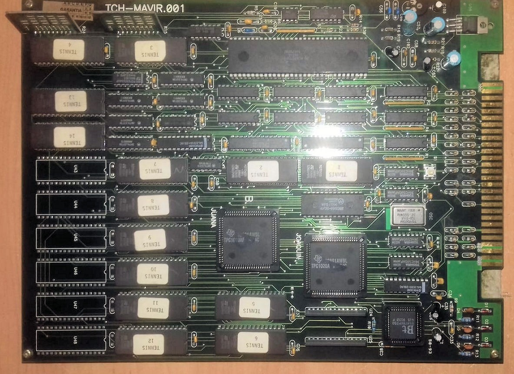

# The Reality Tennis board (TCH)

TCH's first blitter board, as far as the dates go: one 68000, two FPGAs that the silkscreen calls
**JUANA** and **JOAQUIN**, one reading the graphics and the other writing the screen, and two DACs
fed straight from the sample ROMs. It runs the oldest game of the family as MAME dates it, and it is
the one of the two boards MAME already emulated as working before this work began. The hardware was designed by **David
Sandoval** and the game programmed and designed by **Antonio 'Peluko' Carrillo**, as the MAME driver
credits them. Its successor, by everything the two blitters share, is
[the Wheels & Fire board](wheels-and-fire-board.md).

  

<em>The Reality Tennis board of set 2, <code>TCH-MAVIR.001</code> silkscreened at the top. JAMMA edge on the right, the Bt478 RAMDAC bottom right, the two TPC1020AF blitter FPGAs labelled <code>JUANA</code> and <code>JOAQUIN</code> in the middle, the TOYOCOM 32 MHz oscillator beside them, the 68000 at the top, EPROMs labelled <code>TENNIS 1</code> to <code>TENNIS 14</code>, and six empty 32-pin positions down the left. Photo: Jordigahan (Retrojapan.net), <a href="https://www.recreativas.org/reality-tennis-set-1-6230-tch">recreativas.org</a>, CC BY-NC-SA 4.0.</em>

## Everything on screen is a blit

As on its successor, there are no tiles and no hardware sprites: the blitter copies rectangles from
the graphics ROMs into the framebuffer. JUANA reads from the ROMs and JOAQUIN writes to video RAM,
and the driver labels the registers the same way: in the first four words, the high byte is
JUANA's source and the low byte JOAQUIN's destination.

The driver documents eight 16-bit words at `0x700000`, and a blit fires on the **0 to 1 edge** of bit 14 of
word 6. There is no arming step and nothing to reset between blits.

**It scales.** Word 5 holds the ratio as two bytes whose high nibbles are `a` and `b`: the
destination is `(a+1)/(b+1)` of the source on both axes. The game writes `0x0000` before each
value, plays its matches at `0x2233` (3/4) and `0x1122` (2/3), and is only ever seen reducing. Unscaled blits
are not clipped: every walk stops where the low 8 bits of its counter reach the end coordinate. A
destination longer than its source holds the source's last column or row rather than reading past
the rectangle the game declared.

**Index 0 is transparent**, except in the colour fill, which no register asks for: the driver
treats a blit whose source spans are 1 on both axes as a fill, repeating that source across the
whole destination and writing it even when it is index 0. Its own comment says it "seems to be"
the fill.

What it does not have, as far as anyone knows: no direct-write port (the low byte of word 6, which
is the direct-write port on the Wheels & Fire board, has no known function here), no band fill and
no scroll.

## Two planes and a quadrant

The framebuffer is **two planes of 512x256 pixels at 8 bits**: the background, drawn and shown as
it is, and the sprites, composed on top with index 0 transparent. The sprite plane has two pages:
one bit of word 4 says which is drawn into and another which is shown. Flipping the shown page is
what closes a frame, and the page that becomes hidden comes back empty. The game never clears that
half, so the board must; the driver does it on the flip and calls the scheme tricky double
buffering.

Each blit lands in a **quadrant** of 256x256 pixels, chosen by two flag bits: one adds 256 to x and
one changes page. The destination counters are 8 bits wide, so a walk wraps inside its quadrant: a
sprite crossing x=255 is drawn as two blits that overlap by one column, and each spills that column
onto the far edge of its own quadrant, off screen.

The visible window is **320x240 at 60 Hz**, from (1,1) to (320,240): the game anchors its
full-screen pictures on that corner and, as far as anyone has looked, draws nothing on purpose on
column 0 or row 0. Its own clock counts 60 vertical blanks to a second.

No scroll is known: a background that moves is redrawn with the blitter. The palette is the same
Bt478 as on the bigger board, 256 colours at 8 bits a component, the index written to `0x720001`,
the components to `0x720003`, and a third port at `0x720007` for reading.

## The sound: two DACs on the ROMs' data lines

There is no sound CPU and no sound chip. As the driver draws it, the two DACs take their data
straight from the two sample ROMs: a counter drives the low address lines and the 68000 writes the high ones, which
picks the 2 KB block that plays.

| address | channel | ROM |
|---------|---------|-----|
| `0x760000` | DAC 1 | `tennis_4.u59` |
| `0x740000` | DAC 2 | `tennis_3.u52` |

One byte picks the block, and 256 blocks of 2 KB are exactly a 512 KB ROM. Each write leaves a word
whose two bytes the player uses in turn. When there is nothing to play the first block is selected,
and it is empty: there is probably no way to stop the player. MAME plays it at 15360 Hz (60 x 256) and
mixes the first channel at twice the level of the second. The driver's variable names are crossed
against the addresses that write them, so the table is the truth, not the names.

## Interrupts

| level | source | used for |
|-------|--------|----------|
| 4 | vblank | the end of a frame; it also steps the counter the game reads in the top three bits of `0x7e0000` |
| 1 | blitter | a level held while the blitter is idle, dropped by the write that clears the strobe |

The game emits one blit of a list per level 1 interrupt and starts a list by unmasking it, which
only makes sense if the line stays up while the blitter is idle, and that is how the driver holds
it: each blit takes a time per pixel walked, and the line comes back up when it ends. How long a
blit really takes is not known (*What we still don't know*), so the set keeps
`MACHINE_IMPERFECT_TIMING`. No raster interrupt is known.

## What it gives the bigger board, and what it does not

Its driver names every blitter field it knows, and two of its ideas appear again on the bigger
board: a bit that selects the shown page, and an opaque mode that writes
index 0, asked for here by the geometry and there by a register. The video model does not: one
68000 at half the frequency, eight documented blitter words instead of sixteen, and a page flip
that clears by itself, where the bigger board leaves every clear to the game.

## What is on it

The driver's header draws the set 1 board; the photo above is the set 2 one, which the driver
notes as a different revision, `TCH-MAVIR.001`. Turned round, it matches that drawing part by part.

| part | what it does |
|------|--------------|
| 68000P8 | the only CPU, 8 MHz from the 32 MHz crystal by a divisor the driver marks as a guess |
| 2 x Actel A1020B (set 1), 2 x TI TPC1020AF (set 2) | the blitter, JUANA and JOAQUIN |
| Bt478 | RAMDAC |
| 2 x KM424C257 | video RAM, beside the RAMDAC |
| 2 x MT5C256 | work RAM, 64 KB at `0x200000` |
| 28C264 (the set 2 part reads as a `28C64A`) | settings EEPROM at `0x100000`, on the low byte |
| 2 x DAC | sound, one per channel |
| 14 x 512 KB EPROM | 2 program, 10 graphics, 2 sample |
| GAL22V10 (set 1); GAL22V10 and GAL16V8 (set 2) | logic |
| NE555, 74HC404 | in the diagram, no documented function |
| 32 MHz oscillator | the only one the diagram draws; a TOYOCOM part on set 2 |

Set 2 shows a few things the diagram does not: six bare 32-pin positions, U43 to U48, where
neither set fits a ROM; a `GARANTIA` sticker (Spanish for "warranty") with a grid of months to
punch; and a silkscreen marking near C33 that reads `58-93` or `38-93`. Unlike layout A of the
Wheels & Fire board, its component side carries no hand-fitted wire; its solder side is not
published.

The two programs differ by a few hundred bytes, documented on [the game page](../games/reality-tennis.md).

TCH's operator sheet survives too: [the Reality Tennis manual](https://www.recreativas.org/archivo/reality-tennis-tch-manual.pdf),
two scanned pages from Jordigahan and Rubén Casaña (Retro Arcadia Valencia). It gives the controls
(per player an 8-way joystick, Start and three fire buttons), the test menu (Switch Test, Coin
Options, Game Options, Color and Convergency, Sound, Default, Exit) and the maker: TCH S.A., of
Beniaján (Murcia), with branches in Valencia and Madrid.

## What we still don't know

- **Which source pixel a scaled blit drops**, the phase of the scale.
- **How long a blit takes on the board.** The driver gives each blit a time per pixel walked and
  holds a list until the page flips at vblank, a value chosen so that the main loop turns at the
  rate the game's continue countdown counts as seconds; no board has been timed to confirm it.
- **Word 7**, written zero at startup and never again as far as the static count sees, and the loose
  bits of words 4 and 6.
- **What `0x780000` controls**, and what `0x7a0000` holds: the program names it all over, the game
  reads it once.
- **The addresses the program names and the driver does not map**: in a boot-to-match run the game
  touches none of them, so they may be data that looks like addresses.
- **The counter in the top bits of `0x7e0000`**: a frame counter, or the sample address update.
- **The right and bottom edges of the picture, the line count**, whether a walk ever wraps in y,
  and whether the sample clock really is the scanline clock.
- **The CPU divisor**, the NE555 and the 74HC404, the DACs, and the markings the photo does not
  resolve.

## Register reference

The driver's names for the bits, which its author says he chose himself.

**Word 4, flags (`0x700008`)**

| bit | name in the driver | what it does |
|-----|--------------------|--------------|
| `0x0001` | `BLTFLAG_DST_X_DIR` | direction of the horizontal traversal of the destination |
| `0x0002` | `BLTFLAG_DST_Y_DIR` | direction of the vertical traversal of the destination |
| `0x0004` | `BLTFLAG_DST_LR` | destination framebuffer quadrant: adds 256 to x |
| `0x0008` | `BLTFLAG_DST_UD` | the other quadrant axis: selects the second page of the sprites plane (the driver only looks at it when the destination is that plane) |
| `0x0010` | | unidentified |
| `0x0020` | `BLTFLAG_DISPLAY_UD` | visible page of the sprites plane |
| `0x00c0` | | unidentified |
| `0x0100` | `BLTFLAG_SRC_X_DIR` | direction of the horizontal traversal of the source |
| `0x0200` | `BLTFLAG_SRC_Y_DIR` | direction of the vertical traversal of the source |
| `0x0400` | `BLTFLAG_SRC_LR` | source quadrant: adds 256 to the x of the source |
| `0x0800` | `BLTFLAG_SRC_UD` | the other axis of the source quadrant |
| `0xf000` | | source ROM number |

Bits 11 to 15 together form the vertical offset of the source: they enter y in multiples of 256
rows, that is, `BLTFLAG_SRC_UD` and the ROM number are the same field seen in two pieces.

**Word 6, trigger (`0x70000c`)**

| bit | name in the driver | what it does |
|-----|--------------------|--------------|
| `0x00ff` | | unidentified |
| `0x0100` | `BLTSTRT_ROM_MSB` | high bit of the source address: jumps 8192 rows of the graphics surface |
| `0x3e00` | | unidentified |
| `0x4000` | `BLTSTRT_TRIGGER` | triggers the blit on the 0 to 1 edge |
| `0x8000` | `BLTSTRT_LAYER` | destination plane: set = background, zero = sprites |

Of the eight words, one (7) does not have a single identified bit.

How often the program names each hardware address, counted from the 32-bit values in its ROM, so
data that looks like an address counts too.

<!-- generated by scripts/gen-hw-docs.py: do not edit by hand [accesses] -->

| address | symbol | what the driver's map says | references |
|---------|--------|----------------------------|------------|
| `0x700000` | rlt_blitter | Blitter (0x700000-0x70000f) -- blitter_w | 75 |
| `0x700002` | -- | inside rlt_blitter, word 1 | 2 |
| `0x700004` | -- | inside rlt_blitter, word 2 | 4 |
| `0x700006` | -- | inside rlt_blitter, word 3 | 2 |
| `0x700008` | -- | inside rlt_blitter, word 4 | 151 |
| `0x70000a` | -- | inside rlt_blitter, word 5 | 14 |
| `0x70000c` | -- | inside rlt_blitter, word 6 | 13 |
| `0x70000e` | -- | inside rlt_blitter, word 7 | 1 |
| `0x700010` | -- | outside the driver's map | 16 |
| `0x700015` | -- | outside the driver's map | 8 |
| `0x700018` | -- | outside the driver's map | 1 |
| `0x720000` | -- | the word whose low byte is rlt_ramdac_idx | 17 |
| `0x720001` | rlt_ramdac_idx | RAMDAC index_w | 2 |
| `0x720002` | -- | the word whose low byte is rlt_ramdac_pal | 4 |
| `0x740000` | rlt_snd1 | Sample block of DAC 2 (the driver's snd1_w, which stores it in m_data760000) | 14 |
| `0x760000` | rlt_snd2 | Sample block of DAC 1 (the driver's snd2_w, which stores it in m_data740000) | 1 |
| `0x780000` | rlt_sndctrl | Sound control, unknown, usually 0x0044 | 49 |
| `0x780008` | -- | outside the driver's map | 132 |
| `0x78000c` | -- | outside the driver's map | 6 |
| `0x7a0000` | rlt_unknown | Read-only at boot (unknown) | 51 |
| `0x7c0000` | -- | outside the driver's map | 8 |
| `0x7e0000` | rlt_io | io_r (player 1 inputs) | 56 |
| `0x7e0002` | rlt_p2 | Port P2 | 7 |

634 absolute references to 23 distinct addresses.

<!-- end of generated block -->

## Status in MAME

Both sets, `rltennis` (set 1) and `rltennisa` (set 2, the board photographed, a split set with four
files of its own and twelve from the parent), run on `tch/rltennis.cpp`. Their state in MAME, before
this work and now, and here, is [the README's games table](../../README.md#the-games).

## Sources

- MAME's `src/mame/tch/rltennis.cpp`, by Tomasz Slanina: the PCB diagram, the register map, the ROM
  lists and the note on the `TCH-MAVIR.001` revision. The scale register, the visible area from
  (1,1) and the interrupt notes are this repository's, carried by its patch to the driver. The
  driver credits the technical information to Antonio 'Peluko' Carrillo, and the game to him
  (programmer and game designer) and to David Sandoval (hardware designer).
- The game's own code and data, and `hardware/accesses.yaml` for the reference counts.
- The recreativas.org entries for [Reality Tennis](https://www.recreativas.org/reality-tennis-540-tch)
  and for [the set 2 board](https://www.recreativas.org/reality-tennis-set-1-6230-tch) (titled
  "Reality Tennis (set 2)" there, under an address that says set 1), with the photo above by
  Jordigahan (Retrojapan.net), published under
  [CC BY-NC-SA 4.0](https://creativecommons.org/licenses/by-nc-sa/4.0/).
- [The Reality Tennis manual](https://www.recreativas.org/archivo/reality-tennis-tch-manual.pdf),
  scanned and provided by Jordigahan and Rubén Casaña (Retro Arcadia Valencia).
- The game page in this repository: [Reality Tennis](../games/reality-tennis.md).
