# The TCH Wheels & Fire board

Four games ran on this board: **Wheels & Fire**, **Power Ball**, **Kong Ball** and **Radical
Enduro**. It has no tilemaps, no sprite chip and no sound chip. Two FPGAs copy rectangles of
graphics around, and a second 68000 does nothing but mix samples in software. TCH built it in
Murcia, with parts dated 1993 to 1995, and by everything the two blitters share, the
successor of the [Reality Tennis board](reality-tennis.md).

  <a href="../img/sources/wheelfir/wheels-and-fire-p9757.jpg">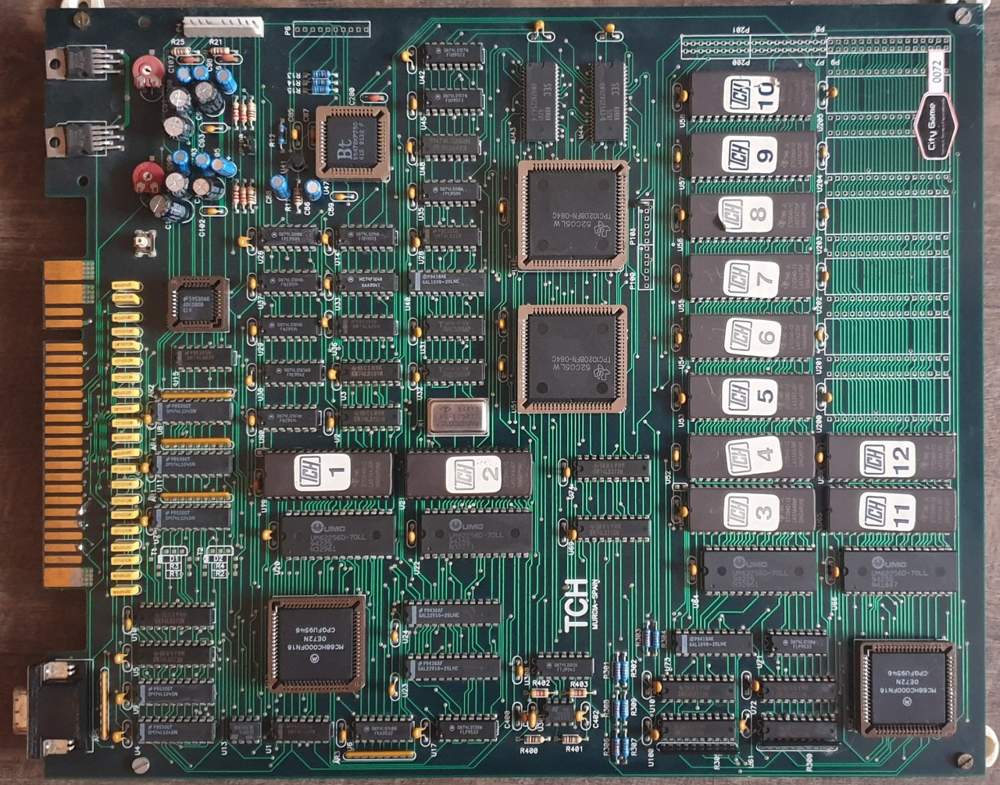</a>

<em>The Wheels & Fire board: the two <strong>TPC1020BFN</strong> blitter FPGAs in the middle, the <strong>Bt478</strong> RAMDAC at the top, the main 68000 bottom left and the sound one bottom right. Photo: Víctor Fernández (City Game), <a href="https://www.recreativas.org/wheels-and-fire-549-tch">recreativas.org</a>, CC BY-NC-SA 4.0.</em>

## Everything on screen is a blit

There are no tiles and no hardware sprites. Every pixel on screen was copied there by the blitter,
one rectangle at a time, from the graphics ROMs into one of two 512x512 framebuffer planes. The
graphics ROMs are seen as pages of 512x512 pixels at 8 bits, two pages per 512 KB chip.

The blitter is sixteen 16-bit words at `0x700000`, and a blit takes three steps:

1. write `0x0000` to word 15 to **arm** it,
2. write the source, destination, page, scale and flags,
3. write `0xffff` to word 15 to **fire** it.

Arming also resets the transparency mode, so every blit says again how it wants index 0 treated.
And it does so in an odd way: there is no transparency bit. Writing `0xff` to the low byte of word
12 asks for **transparent**, writing it to word 13 asks for **opaque**. Sprites use the first so the
background shows round them; big rectangles mostly use the second. Mostly, not always: Wheels &
Fire's High Scores photo is one full-screen blit asked for transparent, so the driver also treats
a background blit that covers the whole window as opaque.

The same sixteen words do three more jobs, all of them in Wheels & Fire:

- **Direct write.** Name a graphics page above the ROMs and the blitter draws nothing: it opens a
  window, and the game then pushes pixels into it one by one through `0x70000d`. Wheels & Fire
  loads its road and its scenery this way.
- **Band fill.** `0xffff` in word 14 turns the next blit into a clear of whole rows, edge to edge of
  the plane, counted round the plane so that a full clear is declared as rows 511 to 510. Wheels & Fire
  double-buffers with it, one fill per frame wiping the half page about to be reused, and clears a
  whole plane between screens with one 512-row fill.
- **Erase in columns.** Bit 3 of word 7 without bit 2 reads no source and writes zeros, walking its
  destination column by column. Wheels & Fire runs it just behind the edge its panning camera leaves.

Zoom is not a percentage. Each axis has a stall counter and a repeat counter, plus a bit that halves
or doubles its clock, and the percentage the game thinks in is only the index of a descriptor in
the program ROM that fills them in. Read that way, the logo that zooms in at the start of Wheels &
Fire's attract lands on its graphic to the pixel. The bits are in the
[register reference](#register-reference).

Radical Enduro builds its whole track out of blits: an isometric track stacked tile by tile by
depth, like Knight Lore, with no raster tricks at all
([how the track is built](../radendur-track-system.md)).

## Two planes and a torus

The picture is two 512x512 planes at 8 bits, composed every frame:

- **The background plane** scrolls, and it is a torus: anything that runs off one edge comes back
  on the opposite one. A strip that crosses the edge is simply drawn in slices, and a panning camera
  walks round the plane for ever without meeting a border. In Wheels & Fire the sky, the mountains,
  the sea and the road all live here, in bands of the same surface.
- **The sprite plane** sits on top, with index 0 transparent and no scroll. It holds two pages of
  256 lines. The board shows the half that bit `0x20` of word 8 names on line 0 of each frame; the
  game writes that bit together with the Y offset (`0x100` or `0`) it adds to every sprite.

The scroll is the clever part. The game writes X and then Y, and the board latches both when Y
arrives. What it loads for Y is a row counter that then advances one row per line by itself, so a
band written once on line 0 shows consecutive rows down the screen. Wheels & Fire goes further:
from the level 5 interrupt it rewrites the vertical scroll on every line, and that is the whole
road, a pre-drawn strip in the background plane read with a different offset on each line. It is
why Wheels & Fire's program names the line counter far more often than Radical Enduro's.

The palette is a Bt478 RAMDAC: 256 colours in one bank, the index written to `0x720001` and the
three components to `0x720003`, 8 bits each, exactly as they sit in the ROM.

<!-- generated by scripts/gen-hw-docs.py: do not edit by hand [video] -->

The visible window is **336x252**.

| plane | height | pages | description |
|-------|--------|-------|-------------|
| background | 512 | 1 | Composed with horizontal and vertical scroll, and the vertical one can change on every scanline. It carries sky, mountains, sea and road on the same surface, in bands. |
| sprites | 512 | 2 | Two pages of 256 lines. Bit 0x20 of word 8 selects the one being shown, which is the same one the game is drawing into that frame: it writes the bit and the sprite Y offset in the same routine. |

<!-- end of generated block -->

## Interrupts of the main 68000

| level | source | used for |
|-------|--------|----------|
| 5 | line counter | the sound mailbox, one word per line, in all four games; in Wheels & Fire also the road's per-line scroll |
| 3 | vblank | the end of a frame |
| 1 | blitter | a **held level**, up while the blitter is idle and when a blit finishes, dropped by the arming write |

The level 1 line being held rather than pulsed matters: the games run their drawing chain one blit
per interrupt, and what paces it is their own interrupt mask, opened and closed around the chain.

## The sound: the second 68000 is the chip

There is no sound chip. A second MC68HC000 at 16 MHz mixes six sample voices in software, two DACs
and three voices each, and its whole program is its level 1 interrupt handler, which runs **once
per scanline**: read a byte from each voice, scale it, add three into each output, write the DACs, and
take the next word of the mailbox from the main CPU.

The sound ROMs of Wheels & Fire, Power Ball and Radical Enduro carry the same program byte for byte,
with only the samples after it changing, which reads as TCH's own sound engine dropped into each
game. Kong Ball's two sound sockets were empty on the board, so there is no dump and MAME marks it
`NO_SOUND`; its main program still carries the same music player.

It reads like code written to save every cycle it can, four ways:

- **It rewrites itself.** The reset copies the mixer into RAM and points the interrupt vector at the
  copy, because the mixer patches its own instructions: the opcode that reads each voice, the volume
  table it uses, the pitch step and the restart point are all immediates inside the code. To make
  voice 3 read through `a3`, the program stamps the word `0x1013` into the instruction. The loop is
  unrolled six times and pays nothing per sample to look anything up.
- **The pitch step is the frequency in Hz.** Each voice adds its step to an accumulator and moves one
  byte when it passes 15625, the number of interrupts per second, so a step of 15625 plays the sample
  at its native rate. A step can only slow a sample down; to go an octave up, the player swaps the
  read opcode for its postincrement form, which advances a byte on its own.
- **Volume is a lookup.** 65 tables of 256 bytes, `table[v][i] = 0x80 + trunc((i - 128) * v / 64)`,
  from silence to full scale. Three scaled bytes add up to at most 765, inside the 10 bits of the R2R
  DAC MAME models, so there is no clipping because none is needed.
- **A sample ends with `0x00`** and the voice jumps to its restart point, which works as a loop or a
  stop depending on where it points. A silent voice is just a voice looping over four bytes of
  silence, so the engine needs no on/off bit.

The mailbox, `0x740000`, runs at the same pace. At vblank the main CPU writes `0xffff`, "apply the
block you hold"; then the line counter carries `0xa0a0` and the next 96-byte block across, one word
per scanline. Each voice gets sixteen bytes: where its sample starts and where it restarts, its
volume table, its read opcode and its step, the last four straight into the mixer's holes, with
zero meaning "keep what you have". Power Ball
and Kong Ball start the block at line 99, after the frame's drawing; Wheels & Fire keeps the line
counter running from line 0 while a game runs; the Radical Enduro dump starts it at line 0, under
the drawing chain, whose blitter interrupt handlers raise the main CPU's mask to 7, so one word comes
late and desynchronises the sound CPU for good; `radendurh` keeps the line and opens those handlers
at mask 4, so the sound's interrupt gets through them as it gets through Power Ball's. There is no
way back: the sound CPU never answers,
never acknowledges and cannot ask for a word again.

The music is not on the sound CPU at all. The main CPU runs a **ProTracker-style module player**:
ProTracker's period table is in the ROM word for word, the song format is 31 instruments, 4 channels
and 64-row patterns, and the effects keep ProTracker's numbers (arpeggio, portamento, volume slide,
position jump, pattern break, set speed). It is not a `.MOD` file, though: no `M.K.`, no names, a
native format already resolved down to bytes, and only half of ProTracker's effects. The last two
voices are left to the game for sound effects, and Wheels & Fire's engine noise pushes one of them
up to 30000 Hz: above 15625, the modulus the mixer's phase step counts against, the game switches
the voice to the post-increment read and sets the step to the rate minus 15625 (`wf_engine_pitch`).

## What is soldered on it

| part | where | what it does |
|------|-------|--------------|
| 2 x MC68HC000 | beside the program ROMs; U62 | main CPU and sound CPU, 16 MHz from the 32 MHz oscillator |
| 2 x TPC1020BFN-084C (TI) | U46, U51 | the blitter |
| Bt478KPJ50 | U47 | RAMDAC, 256 entries of 24 bits ([datasheet](https://www.ardent-tool.com/datasheets/Brooktree_Bt471_476_478.pdf)) |
| 2 x KM428C256J-6 (Samsung) | U43, U44 | video RAM; by the part number 256K x 8 each, the 512 KB of the two planes |
| 4 x 32K x 8 SRAM | U20, U22; U64, U66 | 64 KB for each CPU, probably one byte of its bus per chip |
| ADC0808 | by the JAMMA edge | wheel and pedals |
| ST93C46 | (MAME's notes) | settings EEPROM |
| 32 MHz oscillator | X1 | the only one MAME's notes list; a KDS part on layout A |
| 27C040 EPROMs | U19, U21; U63, U65; U52-U59, U200-U205 | program, sound and graphics, 11 to 18 fitted (MAME's `wheelfir` set names its first sound ROM U83) |
| GAL22V10 x 2, GAL16V8 x 2 | U23, U24; U40, U73 | logic (Kong Ball: a PALCE16V8H at U40 and nothing at U73; layout A: U40 empty) |
| 2 x TDA2003 (ST) | U60, U67 | audio amplifiers, one per output, with the two trimmers for volume |
| push button | by the ADC | probably the Test switch |
| JAMMA edge, VGA connector | edges | the cabinet; the VGA plug links two cabinets, so two players each get their own screen |

<table>
<tr>
<td width="50%">
  <a href="../img/sources/pwball/power-ball-crop-tda2003-p22309.jpg">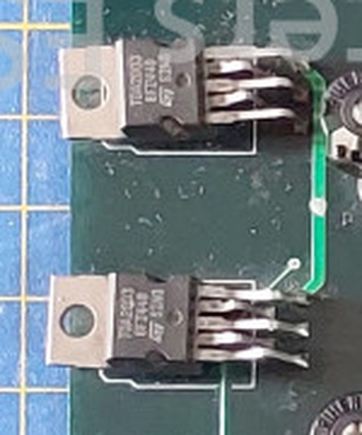</a>
  
<em>Not regulators: the two TO-220 parts at U60 and U67 read <code>TDA2003</code>, an audio amplifier. Power Ball, enlarged and turned.</em>

</td>
<td width="50%">
  <a href="../img/sources/pwball/power-ball-crop-vram-p22309.jpg">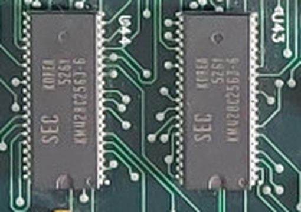</a>
  
<em>The video RAMs at U43 and U44: two Samsung <code>KM428C256J-6</code>. Power Ball, enlarged.</em>

</td>
</tr>
</table>

## One design, two layouts

The four photographed boards carry what looks like one circuit, with the same designators and the
same parts, laid out two ways.
The Radical Enduro board, **layout A**, has its JAMMA edge on top, the ROMs in two rows along the
bottom, and `WHEELS & FIRE` and a large `TCH MURCIA SPAIN` in its silkscreen. Wheels & Fire, Power
Ball and Kong Ball, **layout B**, turn the JAMMA edge to a long side, stack the ROMs in a double
column and say only a small `TCH MURCIA-SPAIN`. On the boards, the games differ in how many
graphics ROMs are fitted: Wheels & Fire U52 to U59, Kong Ball one more at U200, Power Ball up to
U204 and Radical Enduro all fourteen.

  <a href="../img/sources/radendur/radical-enduro-p22595.jpg">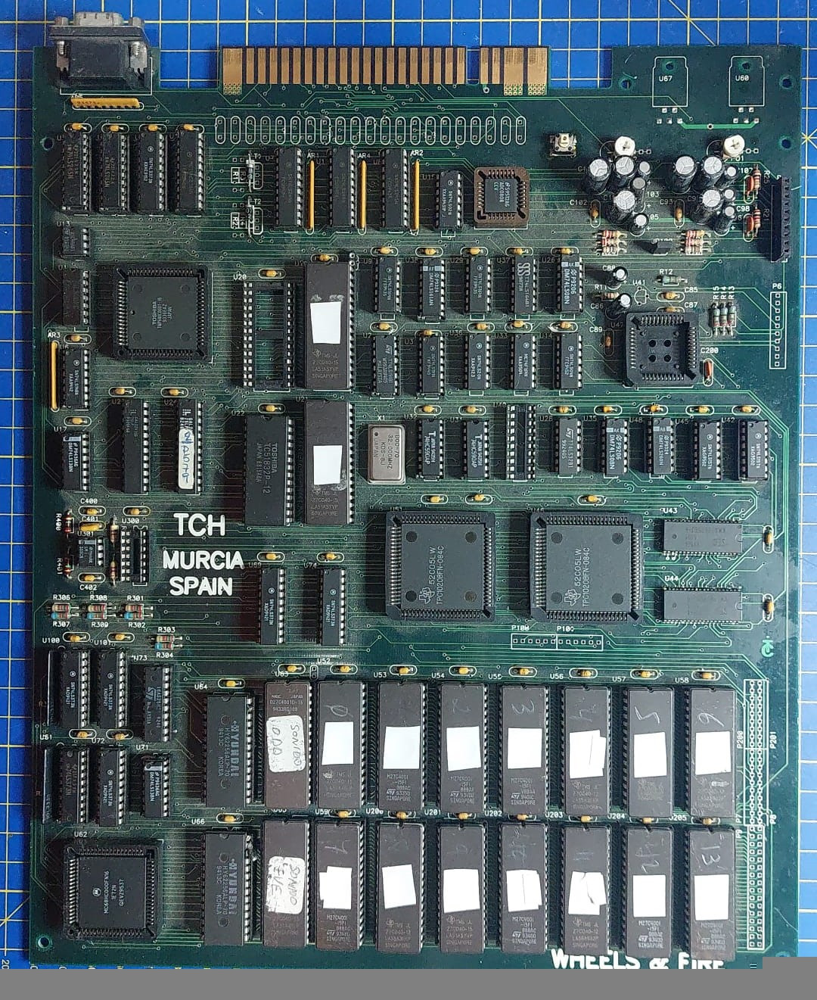</a>

<em>Layout A, the Radical Enduro board. Photo: OldComputers ES, <a href="https://www.recreativas.org/radical-enduro-12338-tch">recreativas.org</a>, CC BY-NC-SA 4.0.</em>

| | layout A (Radical Enduro) | layout B (Wheels & Fire, Power Ball, Kong Ball) |
|---|---|---|
| main 68000 | Toshiba TMP68HC000T-16, date code `9336`, socketed | Motorola MC68HC000FN16 |
| main RAM U20, U22 | U22 a Toshiba TC51832P-12, **U20 empty** | two 32K x 8 SRAMs |
| RAMDAC U47 | **empty PLCC44 socket** | Bt478KPJ50 |
| U40 (a 16V8 on layout B) and U300 | **both empty sockets** | fitted |
| U60, U67 | bare footprints | two TDA2003 |
| T1, T2 by the JAMMA edge | diodes soldered by hand across them | empty, with footprints for D1 and D2 drawn under them |
| hand labels | `SONIDO ODD` and `SONIDO EVE` ("sound") on the sound pair, `2/D579` on the GAL at U24 | `ODD`/`EVE` on Power Ball's program pair, `MUMP3 275F` on Kong Ball's U40 |
| solder side | two yellow wires, a dark one and what looks like a trace cut | Power Ball: one dark wire, lacquer touch-ups, a scorched footprint |

`ODD` and `EVE` mark which byte of the 16-bit bus each chip of a pair carries, as MAME's ROM lists
load them, and `2/D579` and `MUMP3 275F` are the names MAME's PLD dumps carry. What the wires and
the cut fix, nobody has traced.

> **Probably A first, B the corrected revision.** Three clues point that way and none settles it
> alone. Layout A's dated parts are from 1993 and early 1994 (`9336`, `9413`), layout B's run into
> 1994 and 1995 (`9425` on Wheels & Fire, `9534` on Kong Ball). The diodes soldered by hand on A
> have footprints of their own on B. And A carries one game's name in its silkscreen; B carries the
> maker's, and `E1333` with an `LR` logo in the copper of Wheels & Fire's solder side, probably what MAME's
> dump notes write as `N.revisione E133`, the name this board goes by.

<table>
<tr>
<td width="25%">
  <a href="../img/sources/radendur/radical-enduro-p22594.jpg">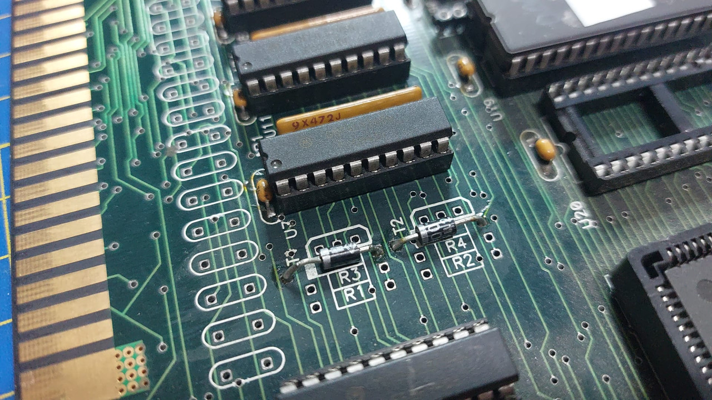</a>
  
<em>Layout A: two diodes soldered by hand across T1 and T2.</em>

</td>
<td width="25%">
  <a href="../img/sources/pwball/power-ball-crop-d1-d2-p22597.jpg">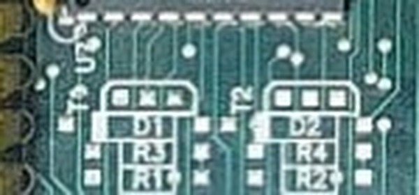</a>
  
<em>Layout B, the same corner: footprints drawn for D1 and D2.</em>

</td>
<td width="25%">
  <a href="../img/sources/wheelfir/wheels-and-fire-crop-e1333-p9756.jpg">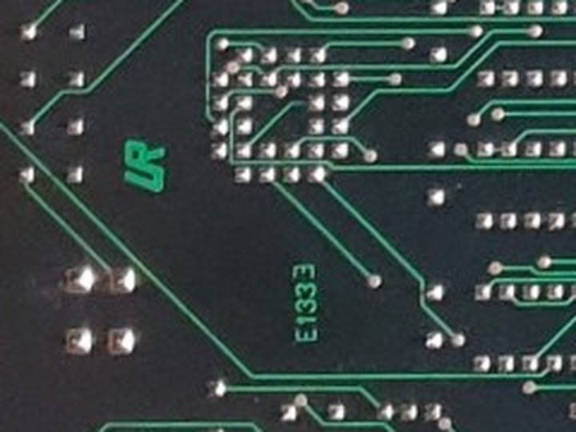</a>
  
<em><code>E1333</code> and the <code>LR</code> logo in Wheels & Fire's copper. Photo: Víctor Fernández (City Game).</em>

</td>
<td width="25%">
  <a href="../img/sources/kongball/kong-ball-p22589.jpg">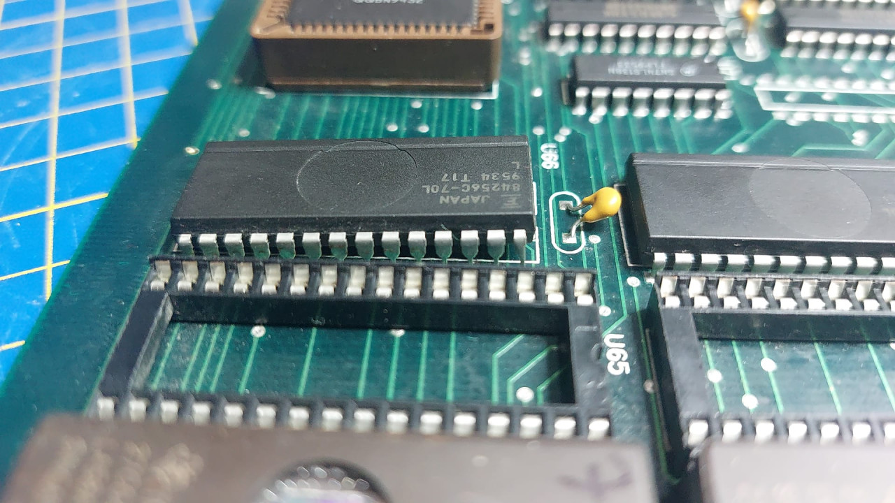</a>
  
<em>Kong Ball's empty sound socket U65, and the SRAM beside it dated <code>9534</code>.</em>

</td>
</tr>
</table>

The Radical Enduro board, as photographed, cannot even show a picture: the RAMDAC socket U47 is
empty, and so are the main RAM socket U20 and the logic sockets U40 and U300. Most likely those
chips were lent to another board: every one of them sat in a socket, and dumping ROMs needs no
running board. U60 and U67 are another matter, bare footprints with no socket, and nothing says why.

<table>
<tr>
<td width="34%">
  <a href="../img/sources/radendur/radical-enduro-crop-u47-p22595.jpg">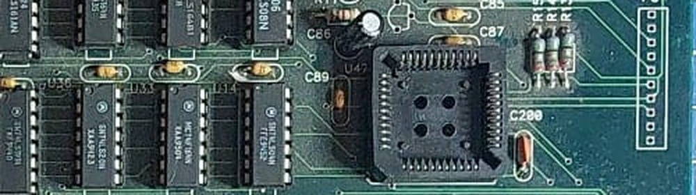</a>
  
<em>U47, the RAMDAC's socket, with the same neighbours the Bt478 has on layout B.</em>

</td>
<td width="33%">
  <a href="../img/sources/radendur/radical-enduro-p22592.jpg">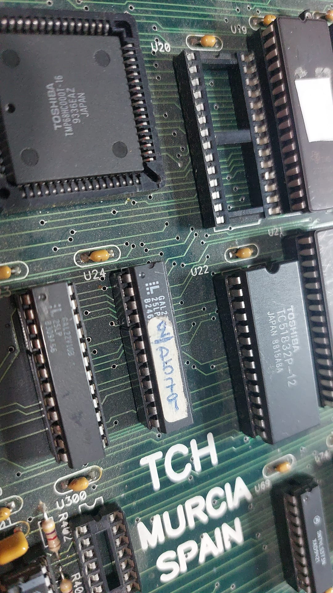</a>
  
<em>The socketed Toshiba 68000 (<code>9336EAZ</code>) and the empty U20 beside U22.</em>

</td>
<td width="33%">
  <a href="../img/sources/radendur/radical-enduro-crop-u40-p22595.jpg">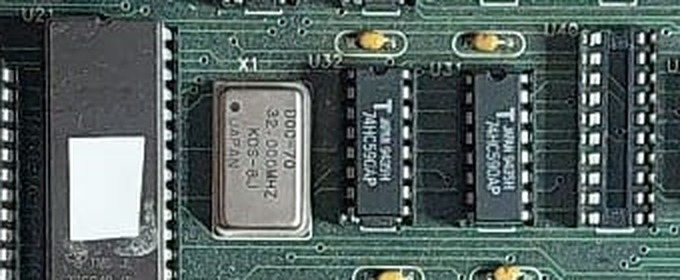</a>
  
<em>The KDS 32 MHz oscillator and, at the right, the empty U40.</em>

</td>
</tr>
</table>

Photos by OldComputers ES unless marked, from the
[Radical Enduro](https://www.recreativas.org/radical-enduro-12338-tch),
[Power Ball](https://www.recreativas.org/power-ball-12336-tch) and
[Kong Ball](https://www.recreativas.org/kong-ball-12337-tch) entries of recreativas.org, CC BY-NC-SA
4.0; the enlarged ones are crops of those photos.

## What we still don't know

- **Blitter words 4 and 5.** All four games write them, Wheels & Fire most of all, and no driver
  reads them: what they do on the board is not known.
- **Bits 11 and 14 of `0x7c0000`**, and what bit 12 drives. Once booted, Wheels & Fire, Power Ball
  and Kong Ball each hold bits 11 and 14 at a constant of their own, so they are no per-frame switch.
- **The link between two cabinets.** The port, its handshake and its command bytes are read in
  Wheels & Fire's code; the protocol only runs with a partner on the other end of the cable.
- **The real rate of the sound interrupt.** Everything assumes 15625 Hz: the mixer's own constant,
  16 MHz / 1024, 32 MHz / 2048 and one mailbox word per line all agree, but nobody has measured a
  board. Whether the field runs at 50 or 60 Hz hangs from the same question.
- **How long a blit takes**, and how long the board holds a level 5 request. The drivers complete
  every blit at once and hold the request until the CPU takes it, withdrawing it when bit 13 of
  0x7c0000 clears or when vblank comes first (both fitted); the length of the drawing chain on
  a real board is unknown.
- **The vertical source direction** of word 8, taken by symmetry with the horizontal one, and the
  scale index bits of word 10.
- **The race's horizon band.** Wheels & Fire's race asks its background for three rows past the end
  of its scenery art above the horizon, so three rows of ground fill show between the sea and the
  road, and the road starts wider than it did on the board. Drawing the background three rows lower
  fits the race exactly and breaks the service mode's convergence grid, so the driver does not do
  it; what the board does differently is not known.
- **The top edge of the picture.** The left edge is pinned at column 0 by Wheels & Fire's title.
- **The main RAM decode.** Kong Ball reaches its RAM as `0x21xxxx`, and both a mirror and a second
  bank fit it; the two 32K chips of each layout B board leave no room for a second bank.
- **Why layout A's sockets are empty**, and what its wires and its cut fix: nobody has traced the
  nets.
- **The P6, P100 and P200/P201 headers**, U300, and the DACs, which no photo identifies.
- **The gear lever.** Button 1 is a low/high gear lever, the cause of the original driver's
  "analogue accelerator is really slow"; what the cabinet had for it, a lever or a button, is not
  known.

## Register reference

Every word and bit of the blitter, the other ports and the memory map, as far as they are known,
generated from `hardware/registers.yaml`; open and refuted entries are marked in their state
column.

<!-- generated by scripts/gen-hw-docs.py: do not edit by hand [registers] -->

### Word 0 (src_u_and_dst_x), at `0x700000` and `0x700001`

High byte: bits 0-7 of source u. Low byte: bits 0-7 of the destination x.

_No individual bits to document: the word is used whole, as the description above says._

### Word 1 (src_u1_and_dst_x1), at `0x700002` and `0x700003`

Low byte: bits 0-7 of the destination end x. The HIGH byte is the source u end in rltennis (BLT_X_END); on this board it carries nothing: see the bit below.

| bit | name | state | what it does |
|-----|------|-------|--------------|
| `0xff00` | src_u1 | refuted | horizontal source end in rltennis; unused on the expanded board |
| `0x00ff` | dst_x1_bits0_7 | confirmed | bits 0-7 of the destination end x |

### Word 2 (src_v_and_dst_y), at `0x700004` and `0x700005`

High byte: bits 0-7 of source v. Low byte: bits 0-7 of the destination y.

| bit | name | state | what it does |
|-----|------|-------|--------------|
| `0xff00` | src_v0_bits0_7 | confirmed | bits 0-7 of the first source row; bit 8 is word 6 bit 9 |
| `0x00ff` | dst_y0_bits0_7 | confirmed | bits 0-7 of the destination start y; bit 8 is word 7 bit 7 |

### Word 3 (src_v1_and_dst_y1), at `0x700006` and `0x700007`

Low byte: bits 0-7 of the destination end y. Symmetric with word 1: the high byte is src_y1 (BLT_Y_END) in rltennis and here it carries nothing.

| bit | name | state | what it does |
|-----|------|-------|--------------|
| `0xff00` | src_v1 | refuted | vertical source end in rltennis; unused on the expanded board |
| `0x00ff` | dst_y1_bits0_7 | confirmed | bits 0-7 of the destination end y |

### Word 4 (unknown_written_by_all_four), at `0x700008` and `0x700009`

All four games write it (wheelfir 7 references, radendur 6, kongball 3, pwball 2) and no driver reads it. The sprite builder zeroes it as a word (0xe4ff4, 0xe50c4) and so does the clear routine (0xe8cea); its low byte receives a PER FRAME value from RAM 0x20bc50 (0x9b47a).

| bit | name | state | what it does |
|-----|------|-------|--------------|
| `0xffff` | unknown_04_whole | **open** | the WHOLE word, with no bits identified yet. All four games write it and no driver reads it |

### Word 5 (unknown_written_by_all_four), at `0x70000a` and `0x70000b`

Same as word 4 and with the same state: the four games write it (wheelfir 10 references) and no driver reads it. Zeroed as a word at 0xe4ffc, 0xe50cc and 0xe8cf2; its low byte receives a per frame value from RAM 0x20bc57 (0x9b464), and 0xa640a and 0xa64c0 write it too.

| bit | name | state | what it does |
|-----|------|-------|--------------|
| `0xffff` | unknown_05_whole | **open** | the WHOLE word, with no bits identified yet |

### Word 6 (page_and_direct_port), at `0x70000c` and `0x70000d`

High byte: graphics page number in bits 10-15, plus the bit 8s of the source. Low byte: DIRECT WRITE PORT, through which the game pushes pixels in by hand.

| bit | name | state | what it does |
|-----|------|-------|--------------|
| `0x0100` | src_u_bit8 | confirmed | bit 8 of the horizontal source |
| `0x0200` | src_v_bit8 | confirmed | bit 8 of the vertical source |
| `0xfc00` | gfx_page | confirmed | the six bits holding the graphics ROM page; a value of 0x1c or above names no ROM and opens the direct-write channel instead |
| `0x00ff` | direct_write_port | confirmed | the direct-write port: each write of this byte is one pixel into the window the last channel-opening command defined |

### Word 7 (flags), at `0x70000e` and `0x70000f`

Blit flags. The high byte is unused; the low one is fully named, "yx-Ledff" (the original driver's "yx-L??ff"): bit 2 reads the source and bit 3 writes index 0.

| bit | name | state | what it does |
|-----|------|-------|--------------|
| `0x0001` | dst_dir_x | confirmed | direction of the horizontal walk over the DESTINATION; set = increasing x |
| `0x0002` | dst_dir_y | confirmed | direction of the vertical walk over the DESTINATION; set = increasing y |
| `0x0004` | reads_source | confirmed | the blit READS its graphic from ROM. It is a flag independent of 0x0008, not the other half of a two-value field: the two appear together in the same frame. A blit with 0x0008 and WITHOUT this one reads nothing and writes zeros, that is, it clears |
| `0x0008` | writes_index_0 | confirmed | the blit ALSO writes index 0 instead of letting the background through. With bit 2 it is a colour fill, the blit the word 14 mark turns into a band clear; alone it is an erase that walks its destination in columns |
| `0x0010` | plane | confirmed | destination plane; set = background, zero = sprites |
| `0x0020` | unused_in_word7 | confirmed | not used in this word; the page bit with this same mask lives in word 8 |
| `0x0040` | dst_x_bit8 | confirmed | bit 8 of the destination x coordinate |
| `0x0080` | dst_y_bit8 | confirmed | bit 8 of the destination y coordinate |
| `0xff00` | high_byte_unused_7 | confirmed | the high byte of word 7 is unused |

### Word 8 (scale_and_scroll), at `0x700010` and `0x700011`

Mixes the SOURCE walk direction and scale in the high byte with the page bit and the high bits of the background scroll in the low one. EVERY blit rewrites it, so its contents do not survive between blits and the scroll has to be captured when the game writes it.

| bit | name | state | what it does |
|-----|------|-------|--------------|
| `0x0020` | visible_page | confirmed | selects which half of the sprite plane is shown |
| `0x0040` | scroll_x_bit8 | confirmed | bit 8 of the horizontal background scroll |
| `0x0080` | scroll_y_bit8 | confirmed | bit 8 of the vertical background scroll |
| `0x001f` | low_five_bits_8 | confirmed | the low five bits of word 8 are not used by the games; bit 0x10 is where bit 8 of the value behind word 4 is folded, and only Radical Enduro could raise it |
| `0x0100` | stall_counter_u_bit5 | confirmed | bit 5 of the horizontal STALL counter (write side): its low five bits are n, meaning n ticks and one stall, scale n/(n+1): 80% = 4, 50% = 1. Bit 5 is set exactly when the OTHER counter (repeat) is active: on the idle counter in pure scales (value 32), on both in the 326 combined scales (60 = 1/2 x 6/5, 75 = 1/2 x 3/2, 90 = 6/7 x 21/20). A combined scale is a descriptor of wf_zoom_desc_x whose two counters both have a non-zero count. The tables the descriptors point at follow the five low bits alone (wheelfir_the_scale_tables_are_the_counters) |
| `0x0200` | stall_counter_v_bit5 | confirmed | bit 5 of the vertical STALL counter, same law as the horizontal one |
| `0x0400` | repeat_counter_u_bit5 | confirmed | bit 5 of the horizontal REPEAT counter (read side): its low five bits are n, meaning one repeated pixel every n, scale n/(n-1): 200% = 2, 150% = 3, 120% = 6. Bit 5 set exactly when the stall counter is active |
| `0x0800` | repeat_counter_v_bit5 | confirmed | bit 5 of the vertical REPEAT counter, same law as the horizontal one |
| `0x1000` | clock_double_u | confirmed | doubles the horizontal scale (x2): the read-side clock halved. Used by every descriptor from 201% to 399%: 400% = 200% (repeat counter 2) with this bit |
| `0x2000` | clock_double_v | confirmed | doubles the vertical scale (x2), same as the horizontal |
| `0x4000` | src_dir_x | confirmed | horizontal direction of the SOURCE walk; set = increasing u. Read against word 7 bit 0 it says whether the copy mirrors |
| `0x8000` | src_dir_y | **open** | vertical direction of the SOURCE walk by symmetry with the horizontal pair; set = increasing v. The driver steps the source row by it |

### Word 9 (high_bits_and_small_scale), at `0x700012` and `0x700013`

Low byte: bit 8 of x1 and of y1, and the flags for scale below 50%.

| bit | name | state | what it does |
|-----|------|-------|--------------|
| `0x0004` | dst_x1_bit8 | confirmed | bit 8 of the final x |
| `0x0008` | dst_y1_bit8 | confirmed | bit 8 of the final y |
| `0x0001` | clock_halve_u | confirmed | halves the horizontal scale (x1/2): the write-side clock halved. Used by every descriptor from 25% to 49%: 25 = 50 (stall counter 1) with this bit, 40 = 80 with it |
| `0x0002` | clock_halve_v | confirmed | halves the vertical scale (x1/2), same as the horizontal |
| `0xfff0` | rest_unused_9 | confirmed | the high twelve bits of word 9 are not used |

### Word 10 (scale_x_and_scroll_x), at `0x700014` and `0x700015`

High byte: horizontal scale data. Low byte: horizontal background SCROLL. The game writes the x first and the y afterwards, so the scroll is captured on the y write, not here.

| bit | name | state | what it does |
|-----|------|-------|--------------|
| `0x1f00` | scale_u_data1 | **open** | five bits of the index used to look up the horizontal scale |
| `0x00ff` | scroll_x_low_byte | confirmed | low byte of the horizontal background scroll |
| `0x4000` | scale_v_extra | confirmed | bit 4 of the vertical stall counter |
| `0xa000` | unused_10 | confirmed | bits 0x2000 and 0x8000 are not used |

### Word 11 (scale_x2_and_scroll_y), at `0x700016` and `0x700017`

High byte: more scale data. Low byte: vertical background SCROLL.

_No individual bits to document: the word is used whole, as the description above says._

### Word 12 (scale_y_and_transparency_a), at `0x700018` and `0x700019`

High byte: vertical scale data. Low byte: one of the two transparency selectors; the game writes 0xff to it for TRANSPARENT mode.

| bit | name | state | what it does |
|-----|------|-------|--------------|
| `0x00ff` | transparent_selector | confirmed | writing 0xff here selects index 0 to be transparent |
| `0xdf00` | scale_v_data | confirmed | vertical scale data in the high byte |
| `0x2000` | unused_12 | confirmed | bit 0x2000 is not used |

### Word 13 (transparency_b), at `0x70001a` and `0x70001b`

Low byte: the other selector; writing 0xff here selects OPAQUE mode, in which index 0 is written instead of being treated as transparent.

| bit | name | state | what it does |
|-----|------|-------|--------------|
| `0x00ff` | opaque_selector | confirmed | writing 0xff here causes index 0 to be written |
| `0xff00` | high_byte_unused_13 | confirmed | the high byte of word 13 carries nothing the blitter uses; Power Ball writes 0xff into it as a side effect of selecting opaque by word |

### Word 14 (selector_companion), at `0x70001c` and `0x70001d`

The game ALWAYS writes 0xffff to it, just as it does to the word 15 trigger, and no driver reads it. It marks the next trigger as the plane clear between screens (see the bit below). Five sites in Wheels & Fire: two in the drawing routines (0xe5402, 0xe5480) and three in the screen-clear ones (0xe8e5c, 0xe8ec4, 0xe9346).

| bit | name | state | what it does |
|-----|------|-------|--------------|
| `0xffff` | clear_mark | confirmed | marks the next trigger as a FILL operation: it does not draw a graphic, it clears to index 0 the band of rows it declares, from edge to edge of the plane |

### Word 15 (trigger), at `0x70001e` and `0x70001f`

Writing 0x0000 ARMS the command and clears the transparency mode latch; writing 0xffff EXECUTES it. The arming comes first and the parameters afterwards, which is what proves that the mode is not inherited between blits. The arming write is ALSO the interrupt acknowledge, the write that drops the blitter's held IRQ line.

_No individual bits to document: the word is used whole, as the description above says._

<!-- end of generated block -->

<!-- generated by scripts/gen-hw-docs.py: do not edit by hand [ports] -->

### `0x740000` soundlatch

The mailbox from the main 68000 to the sound one: a single word with no queue behind it, written once per line by the level-5 handler and read by the sub CPU at 0x780000, one word per line. Writing twice before a read drops the first, and reading twice before a write takes the same word twice: either way the sub CPU's block of 48 words shifts, and with no acknowledgement nothing on either side notices.

_No individual bits to document: the word is used whole, as the description above says._

### `0x7a0000` line_counter

The line counter: the game writes how many lines to wait, the beam decrements it once per line while bit 13 of 0x7c0000 enables it, and at zero the 68000 takes level 5. That interrupt is the SOUND STREAMER's clock on all four games: its handler posts one word per line to the sub CPU through the soundlatch and re-arms the counter with 1 for the next line. In Wheels & Fire the same handler also writes the road's per-line scroll, hence the name "raster interrupt".

_No individual bits to document: the word is used whole, as the description above says._

### `0x7c0000` control_and_link

The board's control word, read and written by the main 68000 through a shadow in RAM (0x200448 in Wheels & Fire, 0x201c26 in Kong Ball). Three things share it: the serial EEPROM (bits 8-10 written, bit 15 read), the line counter's enable (bit 13 written, with bit 12 beside it) and the LINK to a second cabinet over the VGA connector, whose data travels in the low byte and whose receiver status is read on bit 13.

| bit | name | state | what it does |
|-----|------|-------|--------------|
| `0x00ff` | link_data | confirmed | the link's data byte: written, the byte transmitted to the other cabinet; read, the byte received. The driver answers nothing on a read, which is a cabinet with no partner |
| `0x2000` | link_status_and_sound_block_start | confirmed | read, the link receiver's status, one when nothing is pending; written, the line counter's enable: the counter runs only while it is set. The drivers also withdraw a pending level-5 request when it clears; that the board does so is not established |
| `0x1000` | sound_block_end | confirmed | written beside bit 13: Power Ball, Kong Ball and Radical Enduro set it as they clear bit 13 after a block's 48th word, and Wheels & Fire sets it on line 0 with bit 13 still set; what it drives is not known |
| `0x0100` | eeprom_clk | confirmed | written, the EEPROM's clock |
| `0x0200` | eeprom_di | confirmed | written, the EEPROM's data input |
| `0x0400` | eeprom_cs | confirmed | written, the EEPROM's chip select |
| `0x8000` | eeprom_do_and_link_handshake | confirmed | read, the EEPROM data output; written, a handshake line of the link, held low while a byte is awaited. What the wire does with it is not modelled |
| `0x0800` | written_bit_11 | **open** | written; what the wire does with it is not known |
| `0x4000` | written_bit_14 | **open** | written; what the wire does with it is not known |

### `0x7e0000` player_inputs

The two 16-bit input ports (P1 at 0x7e0000, P2 at 0x7e0002): joystick, three buttons, start, coin and the Test switch, active low, with the ADC0808 end-of-conversion on bit 13 of P1. Wheels & Fire folds them, with the three ADC channels, into the latch at 0x20bd5c that the whole game reads, built by the routine at 0xea1f0.

_No individual bits to document: the word is used whole, as the description above says._

<!-- end of generated block -->

### Memory map

<!-- generated by scripts/gen-hw-docs.py: do not edit by hand [memory] -->

| range | name | mirror | state | what it is |
|-------|------|--------|-------|------------|
| `0x000000..0x0fffff` | main_program_rom | -- | confirmed | The main 68000's program and data, 1 MB as two interleaved 512 KB chips. |
| `0x200000..0x20ffff` | main_ram | `0x010000` | **open** | The main 68000's 64 KB of RAM, with 0x210000..0x21ffff reaching the same bytes in the driver: a partial decode that ignores A16. Whether the board decodes it that way or carries a second bank there is not decided. |

<!-- end of generated block -->

### Hardware addresses in the program

How often each game's program names each hardware address. A word write counts only at its even
address.

<!-- generated by scripts/gen-hw-docs.py: do not edit by hand [accesses] -->

Absolute references to each hardware address, counted over the program ROM.
Anything reached through a pointer is not included.

| address | name | radendur | wheelfir | pwball | kongball |
|-----------|--------|------|------|------|------|
| `0x700000` | blit_data | 18 | 27 | 11 | 18 |
| `0x700001` | -- | - | - | 3 | - |
| `0x700002` | -- | 13 | 15 | 8 | 9 |
| `0x700003` | -- | 2 | - | - | - |
| `0x700004` | -- | 16 | 15 | 8 | 9 |
| `0x700005` | -- | 1 | - | - | 1 |
| `0x700006` | -- | 13 | 15 | 8 | 9 |
| `0x700007` | -- | 2 | - | - | - |
| `0x700008` | -- | 2 | 3 | - | 2 |
| `0x700009` | -- | 4 | 4 | 2 | 1 |
| `0x70000a` | -- | 2 | 3 | - | 1 |
| `0x70000b` | -- | 3 | 7 | 2 | 1 |
| `0x70000c` | -- | 15 | 15 | 8 | 9 |
| `0x70000d` | -- | - | 14 | - | 5 |
| `0x70000e` | -- | 14 | 15 | 8 | 11 |
| `0x70000f` | -- | 2 | - | - | - |
| `0x700010` | -- | 13 | 15 | 8 | 9 |
| `0x700011` | -- | 2 | 5 | 2 | 1 |
| `0x700012` | -- | 13 | 15 | 8 | 9 |
| `0x700013` | -- | 2 | - | - | - |
| `0x700014` | -- | 4 | 10 | 8 | 5 |
| `0x700015` | -- | 2 | 2 | 2 | 1 |
| `0x700016` | -- | 4 | 10 | 8 | 5 |
| `0x700017` | -- | 2 | 4 | 2 | 1 |
| `0x700018` | -- | 5 | 10 | 8 | 5 |
| `0x700019` | -- | 6 | 5 | 4 | 4 |
| `0x70001a` | -- | - | - | 4 | 1 |
| `0x70001b` | -- | 6 | 4 | - | 5 |
| `0x70001c` | -- | 6 | 5 | 4 | 7 |
| `0x70001e` | -- | 32 | 47 | 24 | 19 |
| `0x70001f` | -- | - | - | - | 1 |
| `0x720000` | -- | 5 | 15 | 2 | 13 |
| `0x720001` | ramdac_index | - | - | 1 | 1 |
| `0x720002` | -- | - | 17 | - | - |
| `0x720003` | ramdac_pal | 3 | 8 | 2 | 4 |
| `0x720004` | -- | 3 | 7 | 2 | 6 |
| `0x740000` | soundlatch | 6 | 35 | 4 | 12 |
| `0x740001` | -- | - | - | - | 1 |
| `0x760000` | coin_cnt | 3 | 12 | 8 | 7 |
| `0x760001` | -- | - | 1 | 1 | - |
| `0x780000` | adc | 4 | 11 | 3 | 9 |
| `0x780001` | -- | - | 2 | - | - |
| `0x78000a` | -- | 2 | - | - | - |
| `0x78000d` | -- | 1 | - | - | - |
| `0x78000e` | -- | - | 1 | 1 | - |
| `0x7a0000` | line_counter | 9 | 36 | 5 | 11 |
| `0x7a0001` | -- | - | 1 | - | - |
| `0x7c0000` | control_and_link | 15 | 96 | 11 | 18 |
| `0x7c0001` | -- | - | 21 | - | - |
| `0x7e0000` | player_inputs | 8 | 23 | 6 | 45 |
| `0x7e0002` | player_inputs_p2 | - | 1 | 9 | 11 |

- **radendur**: 263 references to 38 distinct addresses.
- **wheelfir**: 552 references to 39 distinct addresses.
- **pwball**: 195 references to 34 distinct addresses.
- **kongball**: 287 references to 38 distinct addresses.

<!-- end of generated block -->

## Status in MAME

| set | driver | status in stock MAME, at the pinned version |
|-----|--------|-----------------|
| `wheelfir` | `tch/wheelfir.cpp` | `NOT_WORKING`, `IMPERFECT_GRAPHICS` |
| `pwball` | `tch/wheelfir.cpp` | `NOT_WORKING`, `IMPERFECT_GRAPHICS`, "mostly complete" |
| `kongball` | `tch/wheelfir.cpp` | `NOT_WORKING`, `NO_SOUND`, `IMPERFECT_GRAPHICS` |
| `radendur` | `tch/wheelfir.cpp` | `NOT_WORKING`, `IMPERFECT_GRAPHICS` |

`NOT_WORKING` here means the emulation is not faithful, not that nothing shows. This repository's
drivers carry their own flags, and the state of each game here is in the README's games table.

## Sources

- MAME's `src/mame/tch/wheelfir.cpp` and `rltennis.cpp`, by Tomasz Slanina: the original register
  map, the ROM lists of the four sets and the original dump notes.
- The 68000 code of the games themselves, disassembled in this repository.
- The recreativas.org entries of [Wheels & Fire](https://www.recreativas.org/wheels-and-fire-549-tch),
  [Power Ball](https://www.recreativas.org/power-ball-12336-tch),
  [Kong Ball](https://www.recreativas.org/kong-ball-12337-tch) and
  [Radical Enduro](https://www.recreativas.org/radical-enduro-12338-tch), and
  [the news of the three boards' preservation](https://www.recreativas.org/noticias/2024/05/18/preservados-tres-juegos-de-tch-power-ball-kong-ball-y-radical-enduro-por-oldcomputers-es-664),
  which also shows the test control panel that came with them.
- Board photos by OldComputers ES and Víctor Fernández (City Game), published by recreativas.org
  under [CC BY-NC-SA 4.0](https://creativecommons.org/licenses/by-nc-sa/4.0/).
