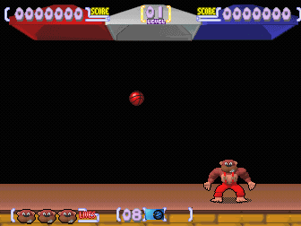
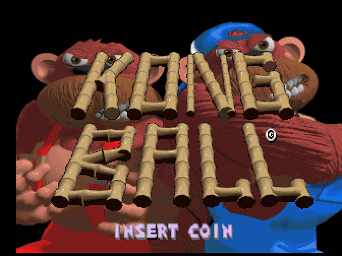
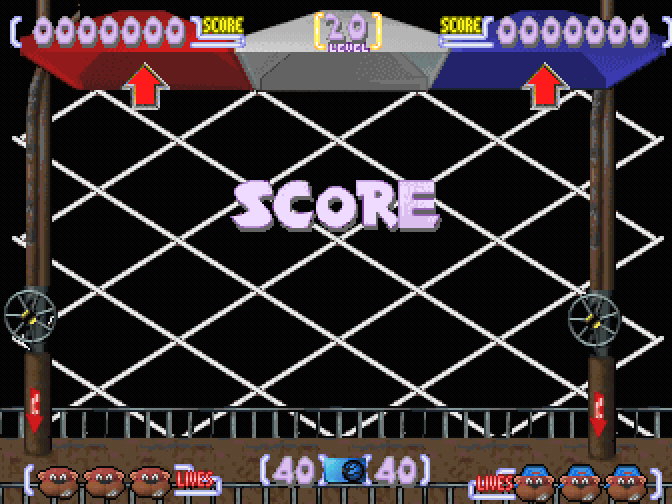

# Kong Ball

  

<em>A game in progress: coin, START, and the gorilla runs under the ball, with the scoreboard at the top and the lives bar at the bottom.</em>

<table>
<tr>
<td width="50%">
  
  
<em>The title over the two gorillas.</em>

</td>
<td width="50%">
  
  
<em>The attract's own demonstration.</em>

</td>
</tr>
</table>

A TCH prototype, also attributed to Digital Dreams Multimedia. A ball game starring two
gorillas, running on the same board as Wheels & Fire and Power Ball. It is the only one of the
three siblings that draws its HUD in the upper half of the sprite plane, so its gameplay shows
at a glance whether the page model is right.

<!-- generated by scripts/gen-games.py: do not edit by hand [facts] -->
| | |
|---|---|
| year | 1997, printed in the ROM itself (a prototype) |
| board | [the Wheels & Fire board](../boards/wheels-and-fire-board.md#one-design-two-layouts), layout B |
| MAME set | `kongball` |
| driver in MAME | `tch/wheelfir.cpp` |
| driver in this repository | the same `tch/wheelfir.cpp`, with the video model rewritten |
| status in stock MAME | **working**, `NO_SOUND` |
<!-- end of generated block -->

## Why it has no sound

This is not an emulation failure: **the board the dump came from was missing its sound ROMs**.
The silence belongs to the dump, not to the driver.

## What it contributes to the video model

It is the game that settles one of the hardest questions in the video model. Its scoreboard and
its lives bar are drawn with bit 8 of the Y coordinate set, that is, in the upper half of the
sprite plane. That makes it the only one of the three that **detects a broken page model**: with
an incorrect model, the whole HUD disappears.

Its title screen is where the clearing between screens shows: the title has to land on the
gorilla, not on the leftovers of the previous screen. The pair on the
[front page](../../README.md#before-and-after) shows both.

## Sources

- [Entry on recreativas.org](https://www.recreativas.org/kong-ball-12337-tch). Dump and photos
  by OldComputers ES, May 2024.
- [The preservation announcement on recreativas.org](https://www.recreativas.org/noticias/2024/05/18/preservados-tres-juegos-de-tch-power-ball-kong-ball-y-radical-enduro-por-oldcomputers-es-664), 18 May 2024, published earlier on oldcomputers.es.
- [The pull request that integrated the three prototypes into MAME 0.266](https://github.com/mamedev/mame/pull/12339).

## Who made it

Digital Dreams Multimedia, and the ROM says so by name: programming by Jesus R. Alvarez, graphics
by Julio Lopez and Oscar Cuesta, with Fernando Perez and Luis Fernando Fernandez. It also carries
the club screen with its email address (`ddm@servicom.es`) and **the team's initials seeded into
the factory high score table** (DDM, JRA, JUL, OSC). Detail:
[teams-and-signatures.md](../teams-and-signatures.md).

## Credits and thanks

<!-- generated by scripts/gen-games.py: do not edit by hand [thanks] -->
- **Tomasz Slanina**: wrote MAME's original drivers for both TCH blitter boards, Reality Tennis's and Wheels & Fire's.
- **David Haywood**: brought the three prototypes, Power Ball, Kong Ball and Radical Enduro, into MAME.
- **Francisco Rabazas / OldComputers ES**: donated the board and dumped the ROMs.
- **OldComputers ES**: dumped the PLDs of Kong Ball and Radical Enduro.
- **ClawGrip**: added OldComputers ES's PLD dumps of Kong Ball and Radical Enduro to MAME.
- **OldComputers ES**: photographed the board.
<!-- end of generated block -->

Developed by Optimiza ([Marcos Hernández](https://www.linkedin.com/in/optimiza/)), in collaboration with [MS-DOS Club](https://msdos.club) and its [podcast](https://www.ivoox.com/podcast-ms-dos-club_sq_f11160693_1.html).
