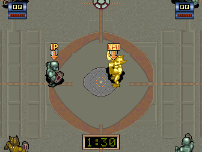
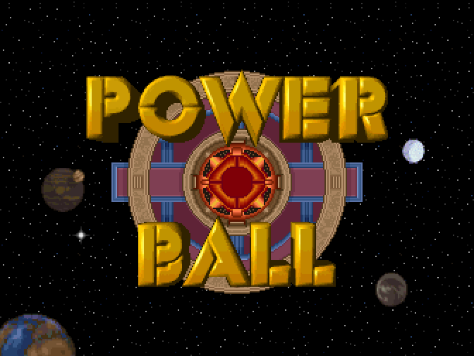
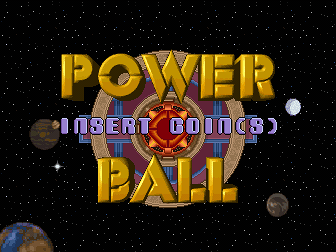
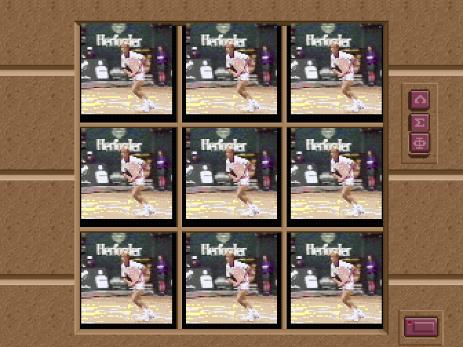
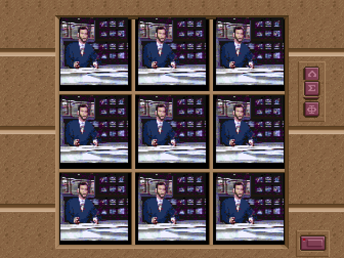
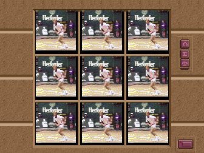
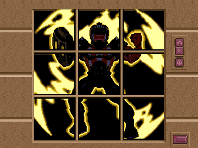
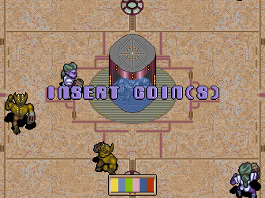
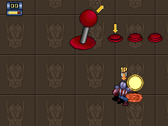

# Power Ball

  

<em>A match in progress: coin, START, and player 1 against the CPU on the arena, with the match clock running.</em>

TCH prototype: a futuristic sports game for one or two simultaneous players, each with a
joystick and three buttons. It is played on a circular arena seen from above, and its attract
mode alternates the title over the starfield with a wall of nine televisions playing digitized
footage.

## The material

<table>
<tr>
  <td width="50%">
    
    
<em>The attract's playable demo: the game plays itself.</em>

  </td>
  <td width="50%">
    
    
<em>The finished title over the starfield.</em>

  </td>
</tr>
<tr>
  <td width="50%">
    
    
<em>The title assembling itself over the starfield.</em>

  </td>
  <td width="50%">
    
    
<em>The wall of nine televisions, with the digitized footage running on all of them at once.</em>

  </td>
</tr>
<tr>
  <td width="50%">
    
    
<em>The attract mode composes digitized photographs without scaling, which is what makes it the clean reference for the board.</em>

  </td>
  <td width="50%">
    
    
<em>The same wall of televisions with another of the digitized sequences.</em>

  </td>
</tr>
<tr>
  <td width="50%">
    
    
<em>One of the characters on the nine televisions, surrounded by electrical discharges.</em>

  </td>
  <td width="50%">
    
    
<em>The arena seen from above, with the players spread around the central circle.</em>

  </td>
</tr>
<tr>
  <td width="50%">
    
    
<em>The controls screen: one joystick and three buttons per player.</em>

  </td>
  <td width="50%"></td>
</tr>
</table>

<!-- generated by scripts/gen-games.py: do not edit by hand [facts] -->
| | |
|---|---|
| year | no known date (a prototype) |
| board | [the Wheels & Fire board](../boards/wheels-and-fire-board.md#one-design-two-layouts), layout B |
| MAME set | `pwball` |
| driver in MAME | `tch/wheelfir.cpp` |
| driver in this repository | the same `tch/wheelfir.cpp`, with the video model rewritten |
| status in MAME | `NOT_WORKING`, `IMPERFECT_GRAPHICS`, with the comment "mostly complete" |
<!-- end of generated block -->

## Its role in this project: the clean reference

It runs on the same board and with the same driver as its siblings, and it looks **clean**: logo,
characters, portraits and gameplay. That makes it the family's control case, because it separates
a fault in a game from a fault in the board model: if a change to the blitter or to the video
breaks something here, the change is wrong.

Its graphics, from the digitized photographs to the arena, come out right, which means the blitter
and the page addressing are faithful.

It is also the game that rules out overly aggressive video models: a double buffer that INFERS the
page instead of reading it from the correct register leaves it black.

And it is the one game that selects opaque mode with a WORD write: three times
(`move.w #$ffff,$70001a` at `0xec16`, `0xf706` and `0xf796`), never as a byte. The selector is
the low byte of that word, so the word write reaches it and the driver honours it. All three land
on commands that already write index 0 by another route (a colour fill and two plane fills), so
whether the mode is honoured there changes no pixel of what the game draws.

**It has sound, and its boot is what made that hard.** The music and effects are streamed to the
sound 68000 one word per scanline by the line-counter interrupt, in blocks of 48 words with no
handshake: a word missed or repeated, and the sound CPU runs garbage for the rest of the session.
Power Ball reads its EEPROM at boot with interrupts masked for several frames and comes out with a
vblank request still pending, so a counter left running would expire just before the next vblank
and cut the first block short. The way out is a bit the game writes itself: bit 13 of the control
port, set at vblank and cleared after the 48th word, enables the counter, and the boot clears it
on its way out. Wheels & Fire keeps it set while it plays, which is why its road keeps its
per-line clock.

## Sources

- [Entry on recreativas.org](https://www.recreativas.org/power-ball-12336-tch). Dump and
  photographs by OldComputers ES, May 2024.
- [The preservation announcement on recreativas.org](https://www.recreativas.org/noticias/2024/05/18/preservados-tres-juegos-de-tch-power-ball-kong-ball-y-radical-enduro-por-oldcomputers-es-664), 18 May 2024, published earlier on oldcomputers.es.
- [The pull request that integrated the three prototypes into MAME 0.266](https://github.com/mamedev/mame/pull/12339).

## Who made it

Its two ROMs carry no credits and no legible signature. Those of its board siblings do:
[teams-and-signatures.md](../teams-and-signatures.md).

## Credits and thanks

<!-- generated by scripts/gen-games.py: do not edit by hand [thanks] -->
- **Tomasz Slanina**: wrote MAME's original drivers for both TCH blitter boards, Reality Tennis's and Wheels & Fire's.
- **David Haywood**: brought the three prototypes, Power Ball, Kong Ball and Radical Enduro, into MAME.
- **David Haywood**: improved the graphics emulation of Wheels & Fire and Power Ball.
- **Francisco Rabazas / OldComputers ES**: donated the board and dumped the ROMs.
- **OldComputers ES**: photographed the board.
<!-- end of generated block -->

Developed by Optimiza ([Marcos Hernández](https://www.linkedin.com/in/optimiza/)), in collaboration with [MS-DOS Club](https://msdos.club) and its [podcast](https://www.ivoox.com/podcast-ms-dos-club_sq_f11160693_1.html).
