# Radical Enduro

  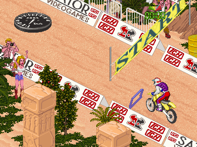

<em>The motocross race: the bike on the track, with the billboards and the scenery stacked by depth.</em>

A TCH prototype attributed to **Sator Videogames**, never released. A motocross game whose track is
built out of sprites stacked by depth, on the same blitter board as
[Wheels & Fire](wheels-and-fire.md). In stock MAME it is `NOT_WORKING`, and a comment in its driver says that
some courses reach gameplay but crash quickly; with this repository's driver and its faults
fixed in the ROM it boots, enters a game and its playable tracks finish the race.

<table>
<tr>
<td width="50%">
  
  
<em><code>radendurh</code>, the clone that plays: its title.</em>

</td>
<td width="50%">
  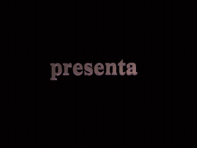
  
<em><code>radendur</code>, the dump as it is: START, the globe corrupts and the game hangs on its own faults.</em>

</td>
</tr>
<tr>
<td width="50%">
  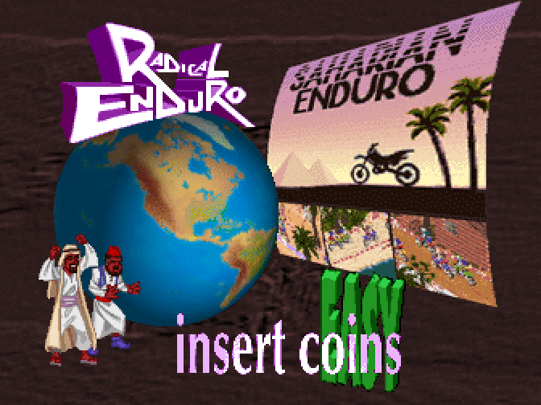
  
<em>The attract mode: the globe, the stage banner and the selected difficulty.</em>

</td>
<td width="50%">
  
  
<em>The dump's title screen, the same as the clone's.</em>

</td>
</tr>
</table>

<!-- generated by scripts/gen-games.py: do not edit by hand [facts] -->
| | |
|---|---|
| year | no known date |
| board | [the Wheels & Fire board](../boards/wheels-and-fire-board.md#one-design-two-layouts), layout A |
| MAME set | `radendur` (the dump, which hangs on its own faults); `radendurh`, a clone whose maincpu ROM has them fixed, its blitter interrupt handlers opened to the sound's interrupt as Power Ball's are, built from the dump by `make radendurh` and published on the [Internet Archive](https://archive.org/details/radendurh) |
| driver in MAME | `tch/wheelfir.cpp` |
| driver in this repository | the same `tch/wheelfir.cpp`, with the video model rewritten and the game's differences in `radendur_state` |
| status in stock MAME | `NOT_WORKING`, `IMPERFECT_GRAPHICS`: a comment in its driver says that some courses reach gameplay but crash quickly |
<!-- end of generated block -->

## What was achieved here

With its faults fixed it boots, enters a game and **five tracks finish the race** with no grey
screen. The faults that are the prototype's own are fixed in the code of the `radendurh` ROM, never
by the driver, which emulates the dump as it is. The same ROM lets the sound's interrupt through
the blitter's interrupt handlers, as Power Ball's handler does, so the music lasts the race. And there it stops: the set
fixes the prototype, it does not finish it, so the zones of scenery the prototype's engine leaves
out of the view stay out. A layer that draws them, an enhancement and not the board, is kept in the
patch table as an option of the builder (`scripts/radendurh.py --with scenery --out <zip>`, a ROM
other than the set's), and besides drawing what the prototype never drew it slows the race clock,
and on the first jungle track, where its frames run latest, the sound dies with it.

The root causes, all read from the code rather than guessed:

- A buffer overrun in the game itself when entering a race: the race palette loop reads one element
  past the end of its array, the palette copier is handed a range outside its table, and it writes
  over the drawing list's cursors. Correcting that loop removes both the wrong colours and the
  overrun.
- Three independent causes of an in-race hang: a register clobbered by the vblank handler, an
  uninitialised search window in five copies of the same block, and an object drawer whose entry
  count wraps round when a cell is busy.
- A drawing fault of the vertical scroll: moving down the track, the strip drawer stamps the props
  of the new bottom row into the top row and leaves the new row bare.
- The difficulty menu, which is in fact wired up: four levels and twelve legs.

## The tracks: what is there, what plays and what was left unfinished

What its sixteen track sections contain, which ones really play, and what was left half done in
the prototype itself. Every claim comes with the image from the channel that supports it: what
the machine paints in MAME, and the same map reconstructed from the ROM with no emulator.

The boot menu offers four difficulties, which map one to one onto the four data
levels and their themes. Within each level you pick the leg (segment);
`section = (level << 2) + segment`, and segment 3 of each level is a byte for byte
duplicate of segment 2 (unused).

| Difficulty | Level | Theme | Sections (seg 0/1/2) | ROM pointer (seg 0) |
|------------|:-----:|-------|:--------------------:|:-------------------:|
| EASY   | 0 | Desert (Egyptian motifs)      | 0, 1, 2   | `0x03e3c8` |
| MEDIUM | 1 | Jungle (KANGAROO billboard)   | 4, 5, 6   | `0x05cec6` |
| HARD   | 2 | Mountain (pines, rock, cabin) | 8, 9, 10  | `0x090452` |
| EXPERT | 3 | (unfinished)                  | 12, 13, 14| `0x09edbe` |

The menu walks `seg` from 0 to 2 and, past 2, jumps to the next level, so
**segment 3 is unreachable**: of the 16 sections in the `0xa2a62` table, only 12 can
be requested.

### What is actually playable, on radendurh

Each section run from boot, with the section loaded read from RAM and the race seen drawn
(`docs/img/radendur/starts/`), against the render of each section made **from the ROM with no
emulator** (`docs/img/radendur/sections/`):

| Track | Section | Contents | How it ends |
|-------|:-------:|----------|-------------|
| EASY, start   | 0 | desert, 3483 objects  | race completed on the game's own time limit |
| EASY, leg 1   | 1 | desert, 6105 objects  | race completed on the game's own time limit |
| EASY, leg 2   | 2 | desert, 6562 objects  | race completed on the game's own time limit |
| MEDIUM, start | 4 | jungle, 9743 objects  | race completed on the game's own time limit |
| HARD, start   | 8 | mountain, 6802 objects| race completed on the game's own time limit |

**Only Level 0 (desert) is finished as a track**, all three of its segments. Of Levels 1
and 2 only the start is done. Level 3 (EXPERT) has no finished track at all: half the sections
hold a large share of their objects at impossible coordinates, and the game kills itself as soon
as it loads most of them. Of the 16 sections, only
five play through in full; the rest have half-finished data, and no emulator fixes that.

The two axes are shown through separate channels on purpose: that a section **is unfinished** is proved
by rendering it from the ROM, with no emulator; that it **hangs** is a different thing, and
is proved by running it.

Section 5 combines both: it draws garbage geometry, with half its entries broken, and it also
hangs halfway. Bad data and a hang, shown through different channels.

### The tracks, one by one

Each leg comes with **two images from different channels**: on the left what the
machine paints in MAME, on the right the complete map of that same section
**reconstructed from the ROM in Python, with no emulator in between**. That the two
agree in colour and in content is the proof that the render model is correct;
and where they disagree is where the next bug lives.

The images in this document are lightweight versions; the full-resolution maps are rebuilt from
the ROM on demand, as [scripts/README.md](../../scripts/README.md) describes.

#### EASY, start: desert with Egyptian motifs

The starting line: columns, stands, crowd and the START arch. Reaches the end of the race.

| In MAME | Map from the ROM |
|---------|------------------|
| 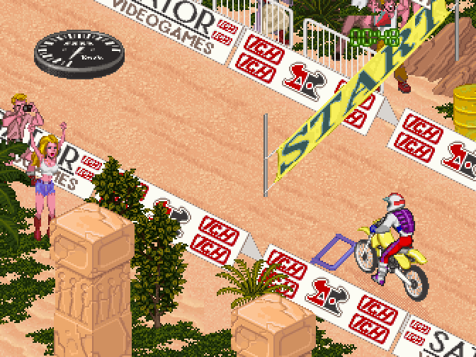 | 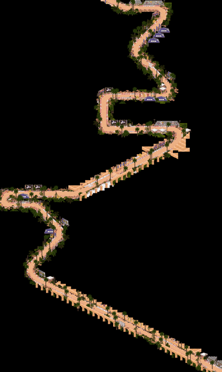 |

#### EASY, legs 1 and 2: desert

The two legs that complete the only finished level in the prototype. Both reach the end of
the race without incident.

| In MAME | Map from the ROM |
|---------|------------------|
| 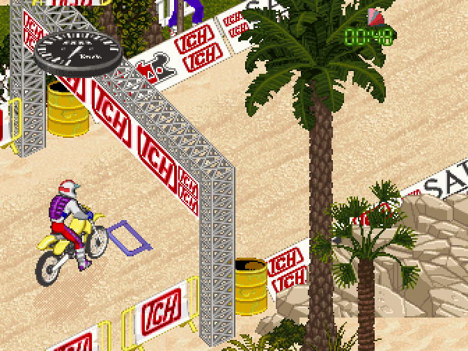 | 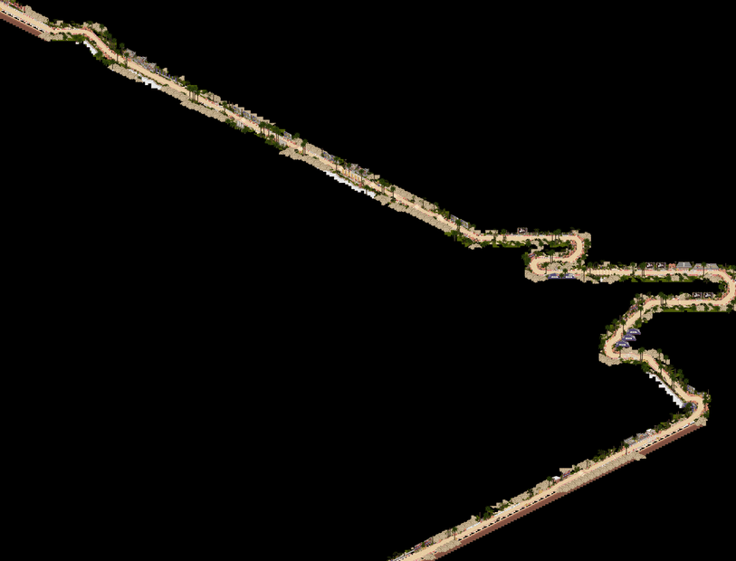 |
| 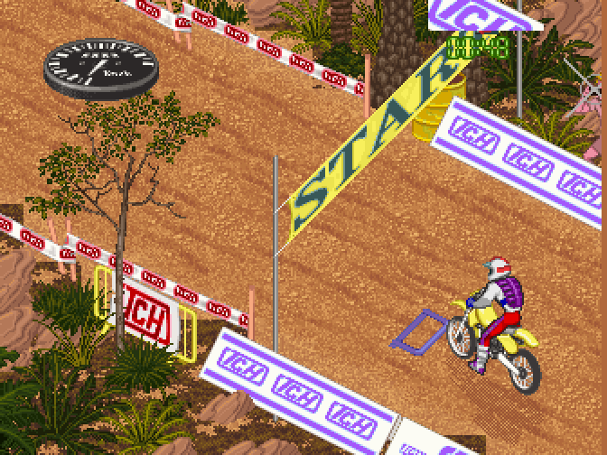 | 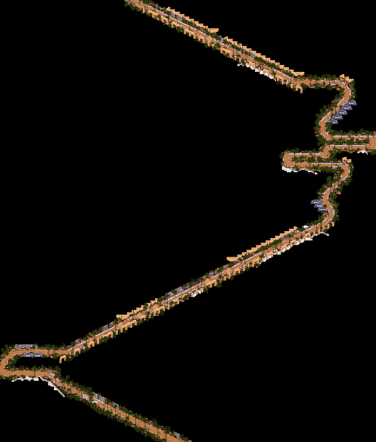 |

#### MEDIUM, start: jungle

Palm trees, metal towers and banners. Halfway through the map the *KANGAROO MOTOCROSS*
billboard appears. Reaches the end of the race.

| In MAME | Map from the ROM |
|---------|------------------|
| 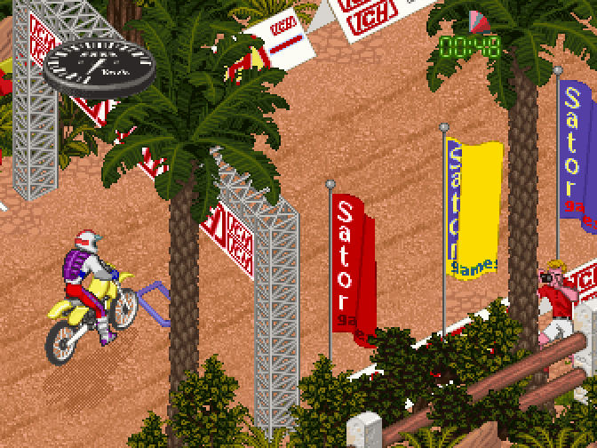 | 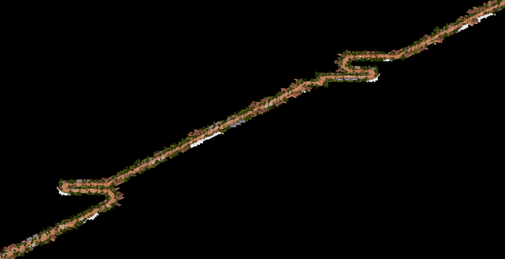 |

#### HARD, start: mountain

Reddish earth, rock, pines and a cabin. Reaches the end of the race.

| In MAME | Map from the ROM |
|---------|------------------|
| 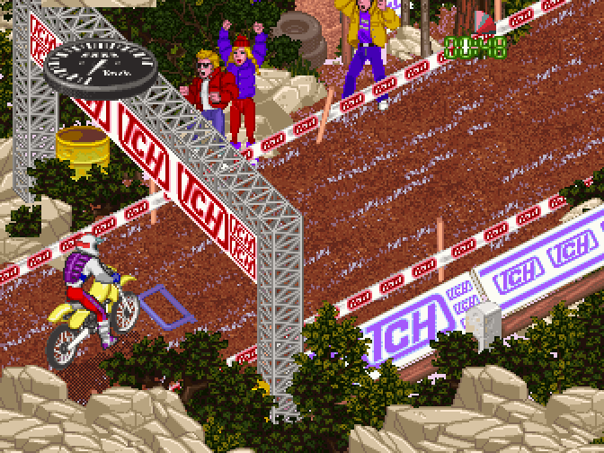 | 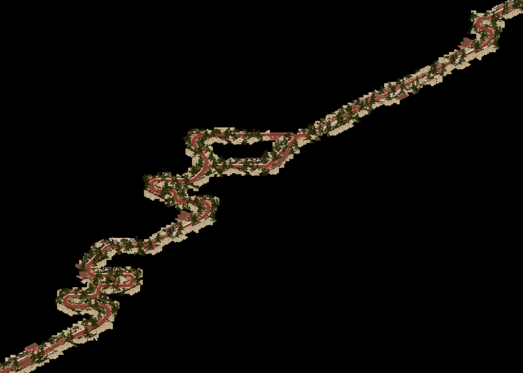 |

### What the prototype left unfinished

Of the 16 sections in the table, **8 never even get drawn**: the game dies right after
START. This is not an emulation fault, and it can be shown without an
emulator: rendered from the ROM, what is inside them are **fragmented traces**, with a large share
of the objects at impossible coordinates.

| Section 5 (MEDIUM leg 1) | Section 12 (EXPERT start) | Section 13 (EXPERT leg 1) |
|---|---|---|
| 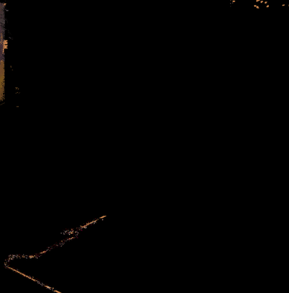 | 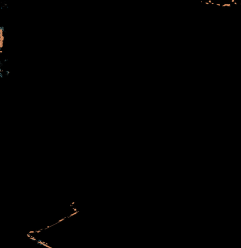 | 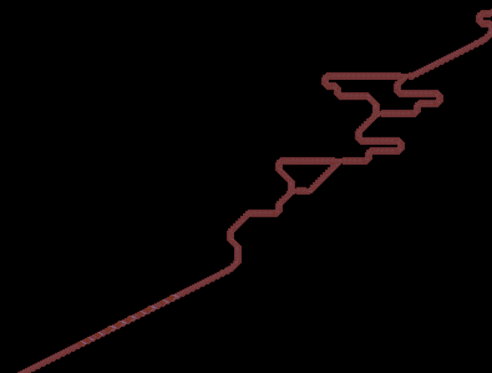 |
| You can make out where the layout was going, but half the objects are missing. | A fragmented trail: the EXPERT level was never built. | **The different case**: no garbage and a continuous layout, but **no scenery at all**. A track with the road laid down and nothing dressing it. |

That last one is the most interesting of the three: it is not corrupt data, it is an earlier
stage of development. The EXPERT level road is laid out and the game was dumped before it
got dressed.

The full sweep of all 16, section by section, is in
[`docs/img/radendur/starts/`](../img/radendur/starts/) (what the machine does) and
[`docs/img/radendur/sections/`](../img/radendur/sections/) (the maps from the ROM).

## The track system

The Radical Enduro engine draws the track as an **isometric sprite system**
(Filmation / *Knight Lore* style): **it does not use raster to warp the screen**
and no 2D tilemap either, but sprites stacked by depth that produce the 3/4 view. All
of it is reconstructed **by reading the ROM and the 68000 code**, and it
is reproduced in Python (`scripts/radendur_track_render.py`, no MAME) by emulating
the blitter, the paint order and the palette, which allows the MAME render to be compared
against an independent reference. Since the **hardware is fixed**, this
model holds for the whole application: with the tracks reproduced faithfully, the
same mechanism explains any screen in the game.

The data format, the two planes and the paint order, and the palette are on their own reference
page: [the Radical Enduro track system](../radendur-track-system.md).

### Paint order detail (zooms)

Cases that illustrate the [per cell model](../radendur-track-system.md#the-two-planes-and-the-paint-order-hardware-model):
the columns end up **in front of** the
banners behind them, and the tall sign comes out **whole** even when surrounded by
nearer vegetation.

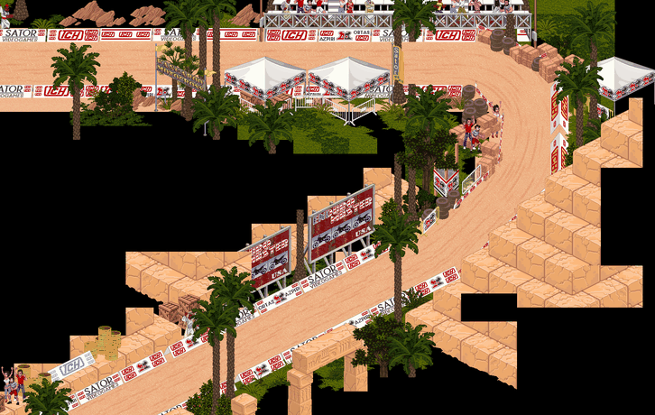
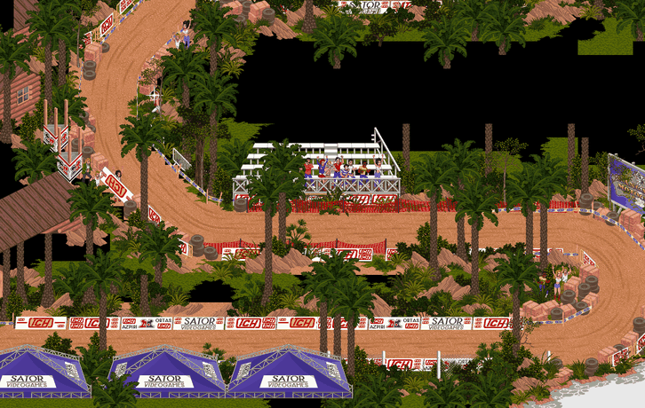
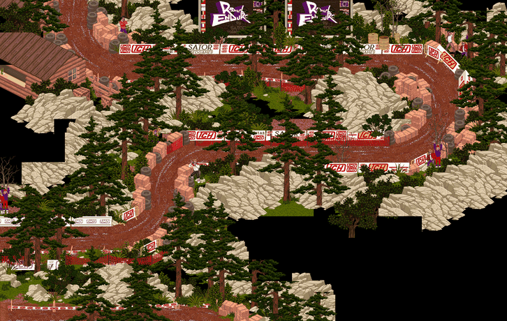

The start and the legs of every documented level have their own detail (zoom into the
stands and signs area) in `docs/img/radendur/detail/`; the complete index, with the source
section of each one, is in `docs/img/radendur/detail/README.md`.

## Sound, and what is still open

**The game has music.** It plays a MOD-style track from the SATOR logo onward: the sound is a
sample streamer clocked by SCANLINES. The line counter at `0x7a0000` drives it through the
level-5 IRQ, one word per line to the sound 68000, and bit 13 of the control port enables the
counter while a block streams.

**The blitter's interrupt handlers decide whether the music lasts.** The sound 68000 takes one word
per scanline with no handshake, so a word that arrives a line late is a word read twice, and from
there it runs garbage. The prototype starts each block at the top of the frame, where its drawing
chain runs, and each of the chain's blitter interrupt handlers raises the main 68000's mask to 7, so
the sound's interrupt waits behind it; on the dump the music dies a few seconds in. Power Ball's
blitter handler leaves the mask low. `radendurh` opens those handlers at mask 4, which still keeps
the vblank out and lets the sound in, and keeps its music through the race however long the blitter
takes to draw.

**Not fixable is the missing per-event triggering.** The game code calls the sound API once, where
its sibling Power Ball calls it for every event, so the per-event EFFECT call sites were never
written. The
samples are in the ROMs and the engine plays them; what is absent is the game code that asks for
them, which is the prototype being unfinished rather than an emulation gap.

**What is open**, said plainly rather than left out:

- The bike's engine sound is not heard, although its samples are in the ROMs.
- `radendurh` is flagged with imperfect sound for the point above: the prototype's code never
  triggers its sound effects.
- The two attract screens right after a race keep part of the race's background. That is what the
  game draws: this board does not clear on its own, and the game's own plane fills
  are modelled.

## Sources

- [Entry at recreativas.org](https://www.recreativas.org/radical-enduro-12338-tch). Dump and
  board photos by OldComputers ES, May 2024.
- [The preservation announcement on recreativas.org](https://www.recreativas.org/noticias/2024/05/18/preservados-tres-juegos-de-tch-power-ball-kong-ball-y-radical-enduro-por-oldcomputers-es-664), 18 May 2024, published earlier on oldcomputers.es.
- [The pull request that integrated the three prototypes into MAME 0.266](https://github.com/mamedev/mame/pull/12339).

## Who made it

**Its two code ROMs contain no readable text at all**, neither in the combined image nor in
either half: no credits, no signature, no date. That fits what it is, a prototype that never
reached manufacturing. The other games on the board do sign their work:
[teams-and-signatures.md](../teams-and-signatures.md).

## Credits and thanks

<!-- generated by scripts/gen-games.py: do not edit by hand [thanks] -->
- **Tomasz Slanina**: wrote MAME's original drivers for both TCH blitter boards, Reality Tennis's and Wheels & Fire's.
- **David Haywood**: brought the three prototypes, Power Ball, Kong Ball and Radical Enduro, into MAME.
- **Francisco Rabazas / OldComputers ES**: donated the board and dumped the ROMs.
- **OldComputers ES**: dumped the PLDs of Kong Ball and Radical Enduro.
- **ClawGrip**: added OldComputers ES's PLD dumps of Kong Ball and Radical Enduro to MAME.
- **OldComputers ES**: photographed the board.
<!-- end of generated block -->

Developed by Optimiza ([Marcos Hernández](https://www.linkedin.com/in/optimiza/)), in collaboration with [MS-DOS Club](https://msdos.club) and its [podcast](https://www.ivoox.com/podcast-ms-dos-club_sq_f11160693_1.html).
