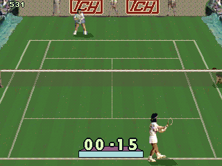
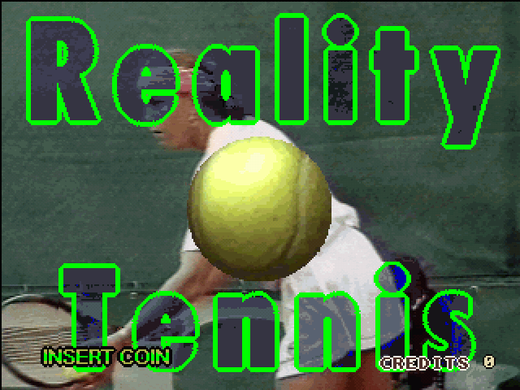
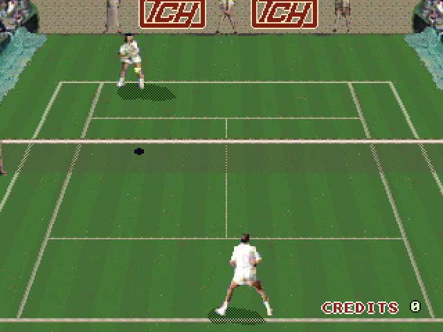
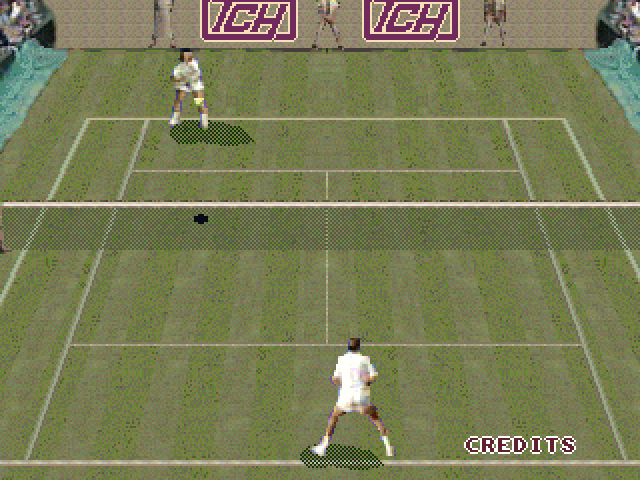
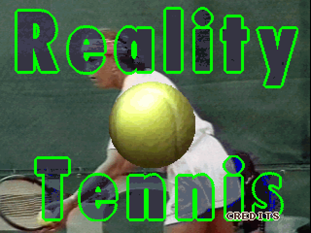
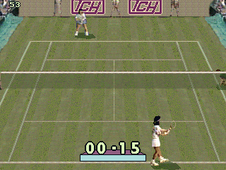

# Reality Tennis

  

<em>A game in progress: coin, START, and player 1 serves against the computer.</em>

The oldest game in the family and the only one stock MAME emulates as working. A tennis game built on
digitised images of period players: the court is drawn in perspective and everything on screen has
been copied there by the board's blitter, rectangle by rectangle. It runs on the first generation of
TCH's blitter board, with a single 68000 at 8 MHz.

**Our emulation**: this game already worked in MAME. The driver here adds, read off the running
game: the blitter's scale register, blit spans counted the way the board counts them, and a picture
that starts at (1,1).

<table>
<tr>
<td width="50%">
  
  
<em>The title over the ball, with the digitised photo behind it.</em>

</td>
<td width="50%">
  
  
<em>The same screen frozen, with the credit counter at the bottom right.</em>

</td>
</tr>
<tr>
<td width="50%">
  
  
<em>The attract's demo rally, with its INSERT COIN and GAME OVER captions.</em>

</td>
<td width="50%">
  
  
<em>A point in play: the court in perspective, the background boards and both players.</em>

</td>
</tr>
</table>

<!-- generated by scripts/gen-games.py: do not edit by hand [facts] -->
| | |
|---|---|
| year | 1993 (`⚠` recreativas.org dates it 1994) |
| board | [the first blitter board](../boards/reality-tennis.md), with a single 68000 at 8 MHz |
| MAME sets | `rltennis` and `rltennisa` |
| driver | `tch/rltennis.cpp` |
| status in stock MAME | **working**, `IMPERFECT_GRAPHICS`, `IMPERFECT_TIMING` |
<!-- end of generated block -->

## Its role: the Rosetta stone

Its driver documents the blitter **bit by bit**, with a name for every field, and that is what makes
it possible to interpret the registers of the larger board, where half a dozen were marked as
unknown. Two mechanisms carry over from it: a visible page selection bit, and an opaque mode which
writes index 0 instead of treating it as transparent.

With one important caveat: **it is a reference for the blitter, not for the video model**. It is a
much smaller board, and its page scheme does not carry over to the larger one.

## The sound, from the programmer's account and the driver's code

The sound hardware is a bank of 2048-byte samples on two ROMs, concatenated by an interrupt that
reloads the top address bits from a register naming the next sample, through two DACs. That is how
the driver emulates it, and it is also how the board's programmer describes it in an account
from the period. The account is a recollection; what backs it is that the driver's code, written long before
from the same information, matches it literally: the driver reloads the high address bits when the counter reaches the end of a 2048-byte
block and shifts the selected bank by eleven bits, one DAC per ROM.

The same account settles who clears the hidden half of the sprite layer, and the game agrees: across
attract and match on both sets, it draws only sprites into the hidden half, flips once per frame and never issues a clearing blit, neither a fill nor a strip
nor a page-sized copy of black. If nobody cleared it, stale sprites would pile up, so **the board
clears the hidden half on the flip**, and the driver's clearing at the change of the display bit is
the hardware, not a workaround. The larger board does not do this on its own: Wheels & Fire clears
its pages from the game, one fill per band.

## The two versions

Reality Tennis exists in two versions, and MAME emulates both: `rltennis` (set 1) and `rltennisa`
(set 2). They are not two different games, nor a game and a bootleg of it: they are **the same
program with a patch** of a few hundred bytes, in seven stretches of the program ROM. The graphics
and the samples have identical CRCs.

The signature hidden in the ROM is **the same in both**, with the same two names and nobody added
or removed: set 2 is a revision by its own authors, not somebody else's rebadge.

<table>
<tr>
<td width="50%">
  
  
<em><strong>Set 1</strong>: the court in saturated grass green, and at the bottom right <code>CREDITS 0</code>, with the digit.</em>

</td>
<td width="50%">
  
  
<em><strong>Set 2</strong>: the same court in olive and straw tones, and <code>CREDITS</code> with no digit after it.</em>

</td>
</tr>
</table>

*The same demo frame in both sets, with no switch touched.*

<table>
<tr>
<td width="50%">
  
  
<em>Set 2's title, with <code>CREDITS</code> and no digit.</em>

</td>
<td width="50%">
  
  
<em>Set 2 played: coin, START, and the serve on the olive court.</em>

</td>
</tr>
</table>

### What changes

**The court palette.** Six of the seven stretches are RGB triplets between `0x12658` and
`0x127f5`: set 1's green `0x457035` becomes `0x6f6e52` and `0x807d4d`, that is, from saturated
grass to olive and straw.

**The credits counter.** The seventh stretch spans 509 bytes from `0x00fa03`, and every
odd-addressed byte in it is shifted by exactly **+4**. On the title screen the only difference
between the two sets is an **8x9 pixel** box at `x 296..303, y 217..225`: the counter's digit. Set 1
always writes `CREDITS 0`; set 2 leaves a bare `CREDITS` until the counter changes value.

### And they are two BOARD revisions, not just two programs

MAME's driver comment about set 2 says its PCB is marked **TCH-MAVIR.001** and carries **two TI
TPC1020AF instead of the two Actel A1020B**, labelled **JOAQUIN (A)** and **JUANA (B)**. That fits
the romset, which brings one extra GAL16V8. The detail of the two revisions is on
[the board page](../boards/reality-tennis.md).

`rltennisa` is also a split set: only four files of its own, the two program ROMs and the two GALs,
with the other twelve inherited from the parent set. Verifying it means resolving that inheritance
the same way MAME does.

## Sources

- [Entry on recreativas.org](https://www.recreativas.org/reality-tennis-540-tch), which dates the game to 1994 against MAME's 1993: the discrepancy is declared above rather than hidden.
- Header of `tch/rltennis.cpp` in MAME, by Tomasz Slanina.
- [The set 2 board page on recreativas.org](https://www.recreativas.org/reality-tennis-set-1-6230-tch), with the PCB photograph and the story of its dump.

## Who made it

The ROM carries a signature hidden at `0x001000`, repeated four times and written identically in
both ROMs (which is why it can only be read by de-interleaving): **"ESTE JUEGO HA SIDO INTEGRAMENTE
REALIZADO POR DAVID SANDOVAL Y ANTONIO A. CARRILLO."** (this game was made entirely by David
Sandoval and Antonio A. Carrillo). Both names appear again years later in
the Wheels & Fire credits, as hardware design and programming. Detail, and the AmigaOS fingerprint
it carries inside: [teams-and-signatures.md](../teams-and-signatures.md).

## Credits and thanks

<!-- generated by scripts/gen-games.py: do not edit by hand [thanks] -->
- **Tomasz Slanina**: wrote MAME's original drivers for both TCH blitter boards, Reality Tennis's and Wheels & Fire's.
- **Antonio 'Peluko' Carrillo**: supplied the technical information behind the Reality Tennis driver.
- **Angelo Salese**: set Reality Tennis's CPU clock.
- **Smitdogg, The Dumping Union**: credited in the MAME commit that added Reality Tennis, which does not state the role.
- **Jordigahan, Ruben Casaña (Retro Arcadia Valencia)**: scanned the Reality Tennis manual.
- **Maria Morpalier**: located the set 2 board.
- **Jordigahan (Retrojapan.net)**: dumped and photographed the set 2 board.
- **Tomas Garcia-Meras**: took the readings of the set 2 board.
<!-- end of generated block -->

Developed by Optimiza ([Marcos Hernández](https://www.linkedin.com/in/optimiza/)), in collaboration with [MS-DOS Club](https://msdos.club) and its [podcast](https://www.ivoox.com/podcast-ms-dos-club_sq_f11160693_1.html).
