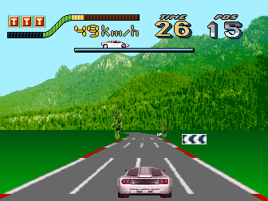
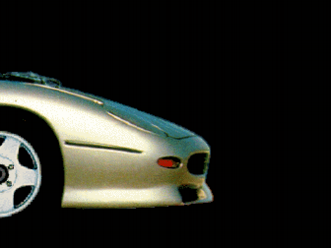
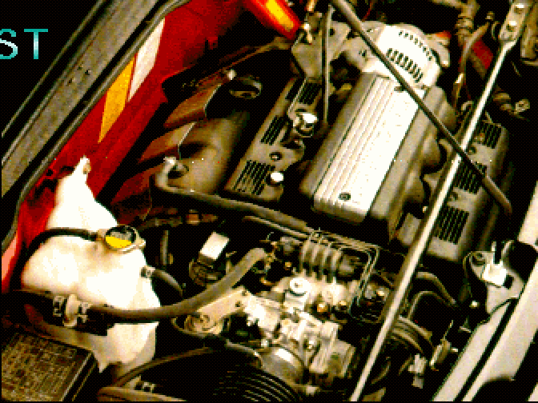
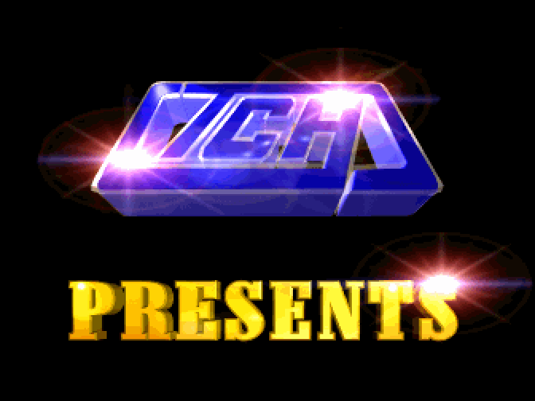
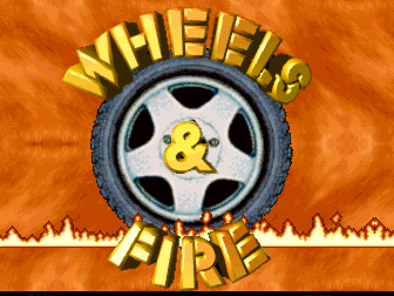
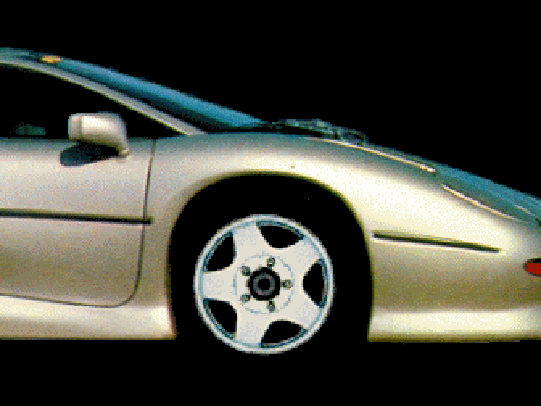
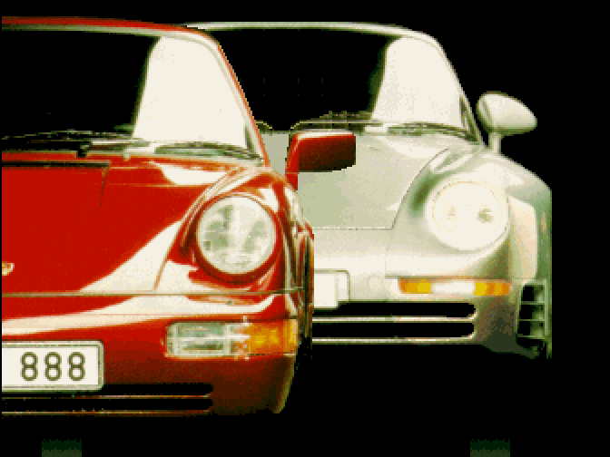
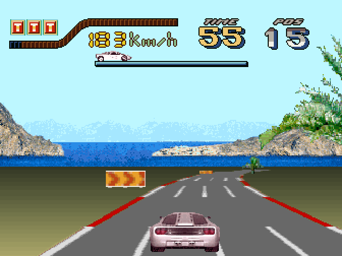
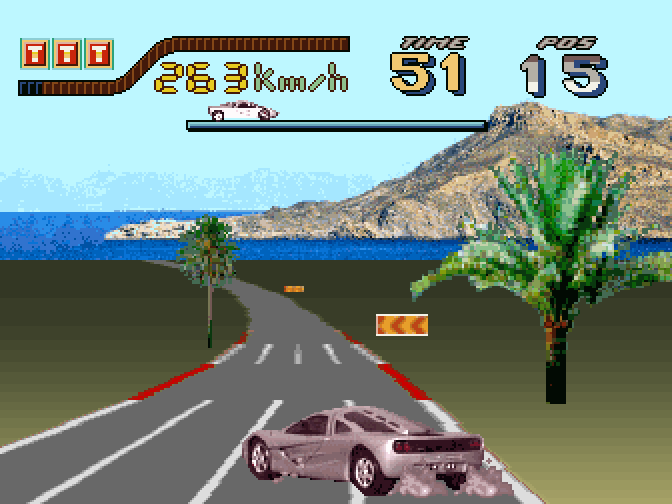

# Wheels & Fire

  

<em>A race in progress: coin, START, and the accelerator to the floor up to top speed.</em>

The game that gives the MAME driver its name. A racing simulator with a link between two cabinets for two-player
play, each with its own monitor. It is the game of the family that uses the complete video
model, and therefore the one that reveals what goes unnoticed in the others.

The rest of the material, moving and still, as this repository emulates it with the
corrected video model:

<table>
<tr>
<td colspan="2" align="center">
  
  
<em>The attract's own race, with the car, the scoreboard and the full horizon.</em>

</td>
</tr>
<tr>
<td width="50%">
  
  
<em>The car presentation: what moves is the camera, not the car.</em>

</td>
<td width="50%">
  
  
<em>The high scores screen, with the digitised photo of an engine.</em>

</td>
</tr>
<tr>
<td width="50%">
  
  
<em>The TCH logo and the PRESENTS that open the attract.</em>

</td>
<td width="50%">
  
  
<em>The title, around a wheel and over flames.</em>

</td>
</tr>
<tr>
<td width="50%">
  
  
<em>The silver sports car crossing the screen, at full page size.</em>

</td>
<td width="50%">
  
  
<em>The two Porsches head on, the red one with licence plate 888.</em>

</td>
</tr>
<tr>
<td width="50%">
  
  
<em>Racing: sea, mountains and the signs at the roadside.</em>

</td>
<td width="50%">
  
  
<em>The same road with a palm tree in the foreground.</em>

</td>
</tr>
</table>

<!-- generated by scripts/gen-games.py: do not edit by hand [facts] -->
| | |
|---|---|
| year | 1997, from an outside source; MAME dates it as `199?` and the ROM carries no year |
| board | [the Wheels & Fire board](../boards/wheels-and-fire-board.md#one-design-two-layouts), layout B |
| MAME set | `wheelfir` |
| driver in MAME | `tch/wheelfir.cpp` |
| driver in this repository | the same `tch/wheelfir.cpp`, with the video model rewritten |
| status in MAME | `NOT_WORKING`, `IMPERFECT_GRAPHICS` |
<!-- end of generated block -->

## Why it is marked as not working

Not because nothing shows up, but because its emulation is not faithful, and the driver header
carries the list: gaps and extra rows of pixels, zoom by lookup table
instead of by parameters, double buffering not applied, layer clearing, wrong coordinates for
the intro sprites, and unidentified layer enable bits.

**Of the eight points on that list, SIX are closed** and two remain open. The closures are in this
repository's driver; in stock MAME all eight are still open. Point by point, against the TODO
exactly as it is written:

| author's point | status |
|----------------|--------|
| *real gfx zoom, based on the zoom params, not lookup table* | **closed, and solved the opposite way round**: the board's law IS table based. Each scale has a 16-byte descriptor in ROM with a shift and two tables, and the percentage is only the index. It goes up to 400 because each axis has one descriptor per scale from 1 to 400 |
| *apply double buffering* | **closed**: they are the two pages of the sprite layer and the bit that declares which one is shown |
| *fix road/sky (extra bits in the scroll reg.)* | **closed**: the scroll is captured when the Y is written, and the background is a 512 torus that wraps |
| *bitmap layer clearing* | **closed**: the game does it, with one fill per frame declaring the half page it reuses |
| *fix wrong coords of sprites rendered into the bitmap layer (intro car)* | **closed**: the car comes out whole; its strip is 632 px on a 512 layer and one slice wraps around |
| *various gfx size/pos glitches* | **closed**: it asked about gaps and extra rows of pixels, and the seam fix and the exact scale law close those |
| *implement (and find) layer enable/disable bits* | **open** |
| *analogue accelerator is really slow* | **the cause is the game's, not the driver's**: the game refuses to accelerate past the second gear's ceiling unless BUTTON 1 is held, which the attract's own controls screen never names. With that button held the car reaches the top gear on the analogue pedal alone. What stays open is the CABINET, not the emulation: whether the pedal had a switch at the end of its travel wired to that button. In MAME the keyboard binds the two to one key (see *How it is driven in MAME*) |

**And the 2 px fill columns are not what is left of that point.** The list asks about gaps and rows
of pixels; the columns are word 14 blits carrying bit 3 **and** bit 2, that is, a clear that does
read its source, and what is missing is where they land. It is a finding of this work, not a
leftover of the list.

**And three findings that are NOT on that list**, because they belong to this repository and not
to the list: the real visible area, 336x252 of the 256 the board scans; that the transparency mode is chosen by the REGISTER written to and not by a flag bit;
and that **the screen clearing is done by the GAME**, by two paths the driver only has to obey (a
word 14 fill erases the band it declares, edge to edge, and a blit carrying bit 3 of word 7 without
bit 2 walks its destination in COLUMNS). A heuristic for when to clear fails at some instant,
because the instant is the game's to choose.

Detail of all of them, with the video model and the blitter, on
[the Wheels & Fire board page](../boards/wheels-and-fire-board.md).

## The zoom is not a percentage

The scale of a blit is not a percentage, and the step over the source image is not computed by
dividing by it. Each scale has a **16-byte descriptor** in the program ROM, and that descriptor
carries a shift and **two lookup tables**; the game maps a source coordinate to the destination
one with

    destination = (2*source + tableA[source] - tableB[...]) >> shift

The percentage is only the index used to look up the descriptor. The routine that does it is at
`0xe47fe`, and the descriptors, one array per axis, are indexed from `0x400` (x) and `0x1d10` (y),
16 bytes per scale, one for each scale from 1 to 400.

Checking that the reading is correct does not depend on any interpretation: scale 100 has to
give the identity and 200 the double, and both do for all 256 columns of a graphics page.

The difference shows. With the exact law, the destination width the game asks for in the logo
zoom that opens the attract matches **to the pixel** what its graphic occupies. With the division
by the percentage the walk runs past the end of the drawing or falls short of it, and where the
overrun reaches the NEIGHBOURING graphic on the same page it paints a column of stray pixels to
the right of the logo, at some sizes only.

## The clearing, which is a fill that declares its band

It is governed by a register the earlier drivers do not read: **word 14**. A blit marked there
does not draw a graphic, it **clears to index 0 the band of rows it declares**, edge to edge of
the layer. Its two columns of width are the SEED, not the destination.

The height is counted on the torus: the screen clear of a transition arrives as `y=511..510`,
that is 512 rows wrapping around, and a raw subtraction gives zero.

With that, **the game does the double buffering itself**: its fills declare the half page it is
about to reuse, alternating between rows 0..255 and rows 256..511.

The test bench is **Kong Ball**, where the symptom comes out bare: without this, on entering a
game the two gorillas from the presentation screen are still visible behind the playfield,
because the game never touches the background layer again for the whole match.

## Determinism over long runs

Left running at real speed, the attract loop repeats lap after lap without drifting. Four of the
screens (car crossing, two Porsches, lone Porsche, wheel) last the same number of frames on every
repetition; only the demonstration match's length varies, because the race ends when it ends, not
on a fixed clock.

The signature that identifies each screen is the set of graphics pages it reads, read from a debug
session watching the blitter's source page as the screens go by, the same technique the attract
cycle table below uses.

## Why the scenery could jump half a screen

The control that accompanies the background scroll carries bit 8 of both coordinates in the same
byte, and the routine that pins the upper band on a slope rewrites it with a constant in order to
set the **y** bit: it wants to read from the upper half of the layer, which is where the scenery
lives. The **x** bit falls with it, and the routine only restores the control on its last
iteration.

Since the restore does not write the y again, a model that only looks at the control when it
latches the scroll never sees it, and the x stays 256 px out of place until the next write further
down the band: on screen, a second and a half of mountains half a screen out of place, jumping in
and out while the road lines stand still. Applying that bit as soon as the control is written
keeps the scenery where it belongs.

**On the car screen, it is the camera that moves, not the car.** Its going out on the right and
coming in on the left is the wrap of the 512 torus, not a clipping bug: the background WRAPS, and
clipping it would split the car with a black band.

## The visible area is 252 lines, and an edge-anchored sprite says so

The board **scans** 256 lines: the game describes them all with per-line scroll, arms its raster
interrupt up to 255 and draws on the last ones. But it **shows 252**, and that is a different
property that only a sprite anchored to the bottom edge can measure.

There is one on this screen: the portrait of the girl in the race. It slides in from below with its
bottom edge **pinned at row 255**, growing in height, and its resting position has the edge at
**251**, where its silhouette ends with a finished outline. 251 is exactly `H-1` for `H = 252`, and
the two facts only fit together with that number: with 256 there would be four rows of asphalt below
it, and it would look as if it were floating.

It also matches what was already known about the width: the game declares **336 to draw and 340 to
clear**, four columns of difference. Vertically that is four rows, the same number. The framebuffer
has a margin that gets cleared and is not shown, and the `y1 = 0xff` of the game's clipping
rectangle is the maximum of a byte, that is a generous cap, not the height of the monitor.

## It is the one that demands the most from the hardware

Of the four games on the board, it is the one that uses the complete video model: per-line scroll
for the road, zoom on the sprites, two pages and transitions with clearing. That is why it is the
one that reveals the faults that go unnoticed in Power Ball or Kong Ball.

## Two linked cabinets

The board's service menu has a COMUNICATION page, with NUMBER OF PLAYERS, PLAYER NUMBER and WAITING
FOR ANOTHER PLAYER (strings read from the ROM), so two boards could race each other. The physical
half comes from the programmer's account from the period: the link ran over the VGA connector
already noted on the PCB, and the cable also synchronised the horizontal-line interrupts of both
boards, which is why the handshake between two cabinets uses the same technique as the one between
the two CPUs of a single board. MAME does not model the link, and it is part of what "fully
emulated" means for this board.

## How it is driven in MAME

The board serves two cabinets, a steering-wheel one and a joystick one, and asks which at the door
of its service menu; the driver models the wheel cabinet by default and offers the other as the
`Cabinet` setting in MAME's machine configuration. The game needs button 1 held to accelerate past
the second gear's ceiling, so on a keyboard that button shares the accelerator's key: one key is
full throttle, as one pedal-and-button is on the cabinet.

| control | keyboard | pad (MAME's defaults) |
|---------|----------|-----------------------|
| steering wheel | left / right arrows | left stick |
| accelerator, full throttle (pedal and button 1) | left Shift | trigger and first button together |
| accelerator alone (what the menus and the high-score table accept on) | left Ctrl | trigger |
| brake | left Alt | second trigger |
| turbo (button 3) | Space | third button |
| coin, start, test switch | 5, 1, F2 | |

Up on a joystick would be a second, weaker accelerator (the game folds it into the pedal's bit), so
the wheel cabinet has no joystick directions at all.

## Sources

- [Entry at recreativas.org](https://www.recreativas.org/wheels-and-fire-549-tch). Board photos
  by Victor Fernandez (City Game); documentation by Victor Fernandez and Tomas
  Garcia-Meras.

## The attract cycles

The attract is made up of eight cycles. The table comes from annotating each blit with the pointer
of the graphic it reads from ROM and then dumping that graphic to PNG to identify it.

Cycle 7, the demonstration match, runs until the race ends.

**There is no state variable to read.** Nearly every blit of one loop comes from the same place:
the blitter interrupt handler at `0xe5274`, which walks a sprite list the main loop has filled
in. Neither the program counter nor the stack tells one cycle from the next, because the drawing
code is always the same. What changes is the **material**: each screen uses its own pages of the graphics ROM, and
that set of pages is the signature that identifies the cycle.

| Cycle | Gfx pages | Content |
|-------|-----------|---------|
| 0 | 0, 2, 4, 15 | the TCH logo zooming in, and PRESENTS |
| 1 | 0, 2..5, 8, 9, 11, 14 | the silver sports car crossing the screen |
| 2 | 0, 2, 4, 8, 10, 12..14 | the two Porsches head on, the red one with licence plate 888 |
| 3 | 0, 4, 5, 8 | the silver Porsche, alone |
| 4 | 0, 2, 4, 5, 8, 10 | the wheel in flames |
| 5 | 0..2, 4, 5, 8, 10, 13 | the WHEELS & FIRE title |
| 6 | 0..2, 5, 9, 12..14 | the circuit map |
| 7 | 0..15 | demonstration match, which requests most of the loop's blits |

**Cycle 1 does not move the car: it moves the camera.** The horizontal scroll sweeps the 512 torus
at 5 px per frame and goes all the way round in about 100 frames, so the car, which is standing
still on the layer, goes out on the right and comes back in on the left. What cleans it up are the
curtains of bit 3 of word 7, which walk the destination in columns and follow right behind the edge
the image leaves by. Without them, cycle 2 would start with the remains of cycle 1 on top, and
cycle 3 with the red Porsche of cycle 2 stuck to it, as if that screen had two cars.

The largest graphic each cycle requests, with its address in the graphics ROM, which is how the
material of each screen is identified:

| Cycle | Page | Source | Size | Address |
|-------|------|--------|------|---------|
| 0 | 15 | (1, 158) | 260x120 | `0x3d3c01` |
| 1 | 3 | (1, 0) | 195x225 | `0x0c0001` |
| 2 | 4 | (355, 0) | 149x107 | `0x100163` |
| 3 | 5 | (175, 0) | 118x173 | `0x1400af` |
| 4 | 4 | (179, 116) | 173x173 | `0x10e8b3` |
| 5 | 4 | (179, 116) | 173x173 | `0x10e8b3` |
| 6 | 5 | (1, 174) | 164x93 | `0x155c01` |
| 7 | 2 | (0, 103) | 170x183 | `0x08ce00` |

### How it was read

The graphics ROM is not a tilemap: it is flat 512x512 pages of 8-bit indices, and the blitter crops
whatever rectangle it wants out of them. So a "sprite" does not exist as an entity there, only as
(page, x, y, width, height), and the way to recognise one is to cut that rectangle out of the ROM
and look at it. The colours are the other half and are not in that ROM: the BT478 is reloaded in
bursts, so one attract screen's palette is not the next one's, and it is read off the running
machine.

## Who made it

The full credits are in the ROM, at `0x0e3894`: executive producer Francisco Chacon, adviser
Jose Sanchez, **hardware David Sandoval**, **programming Antonio Carrillo**, auxiliary programming
Fernando Jimenez, and graphics Javier Martinez, Francisco Bocanegra and **Joaquin Perez**. The
first two in bold also sign [Reality Tennis](../boards/reality-tennis.md) in 1993, and **one of the
two FPGAs of the Reality Tennis board is labelled "JOAQUIN"**, like the graphic artist. Detail:
[teams-and-signatures.md](../teams-and-signatures.md).

## Credits and thanks

<!-- generated by scripts/gen-games.py: do not edit by hand [thanks] -->
- **Tomasz Slanina**: wrote MAME's original drivers for both TCH blitter boards, Reality Tennis's and Wheels & Fire's.
- **David Haywood**: co-wrote MAME's first Wheels & Fire driver.
- **David Haywood**: improved the graphics emulation of Wheels & Fire and Power Ball.
- **Victor Fernandez (City Game)**: photographed the Wheels & Fire board.
- **Tomas Garcia-Meras**: collaborated on the Wheels & Fire entry.
<!-- end of generated block -->

Developed by Optimiza ([Marcos Hernández](https://www.linkedin.com/in/optimiza/)), in collaboration with [MS-DOS Club](https://msdos.club) and its [podcast](https://www.ivoox.com/podcast-ms-dos-club_sq_f11160693_1.html).
